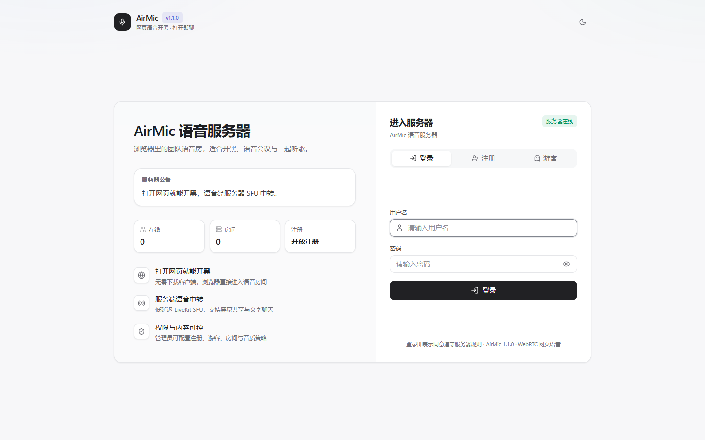
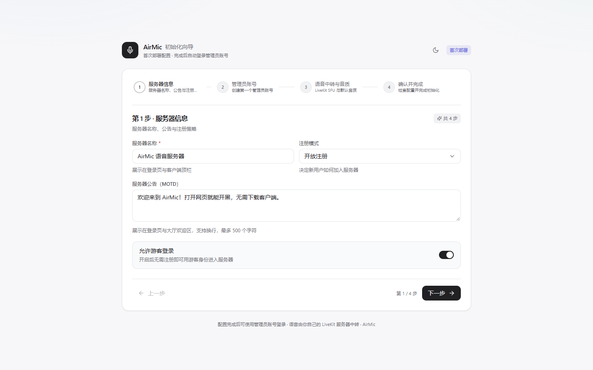
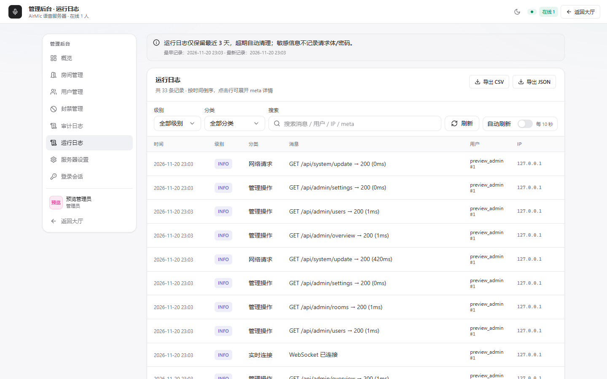

# AirMic

**打开浏览器就能开黑的网页语音平台。** AirMic 的语音走**服务端 SFU 中转**：浏览器只与自建的 [LiveKit](https://livekit.io/) 媒体服务器建立 WebRTC 连接，音频由服务器转发给房间内所有人，**不做浏览器之间的 P2P/Mesh 直连**。因此单房间可以稳定支持 **50–100+ 人**，同时依然无需安装客户端，也不依赖原生模块（SQLite 使用 Node 内置的 `node:sqlite`）。

> 适用场景：小队开黑、内网语音室、桌游/剧本杀房间、远程协作的语音讨论、频道式语音社区。
> 想了解内部实现？见 [docs/ARCHITECTURE.md](docs/ARCHITECTURE.md)；部署到服务器见 [docs/DEPLOY.md](docs/DEPLOY.md)。

---

## 功能特性

- **账号体系**：注册 / 登录 / 游客登录；注册模式支持开放、邀请码、关闭；角色分为管理员 / 版主 / 用户 / 游客，权限点在服务端校验。
- **部署初始化向导**：首次部署访问 `/setup`，可视化创建管理员、填写服务器信息、配置 LiveKit 语音中转并自动创建默认房间；可用 `SETUP_TOKEN` 保护初始化入口。
- **服务端 SFU 语音（LiveKit）**：浏览器 ⇄ 自建 LiveKit 媒体服务器，音频经服务器中转；支持麦克风开关、耳聋、按键说话（PTT）、每用户本地音量、说话高亮、连接质量等级与延迟提示、断线自动重连。
- **大房间**：SFU 模式没有"每多一人多一路 P2P 上行"的限制，单房间默认 100 人、可配置到 500 人；实际容量取决于服务器带宽与 CPU。
- **音质可调**：内置 4 个预设（省流语音 / 标准语音 / 高清语音 / 音乐）与自定义参数；支持服务器默认、房间覆盖、本机覆盖三级生效顺序。
- **屏幕共享**：房间内共享屏幕画面（同一时间只允许一人共享），同样经 LiveKit SFU 转发。
- **房间聊天**：文字消息、系统提示、历史记录（可配置保留条数），聊天限流与长度校验。
- **管理后台**：概览仪表盘、房间管理、用户管理（角色 / 踢出 / 强制静音 / 移动房间）、封禁管理（账号或 IP）、审计日志、服务器设置（含 LiveKit 语音中转、默认音质、注册策略）、登录会话。
- **部署友好**：Docker Compose 一条命令同时启动 AirMic 与 LiveKit；也可裸机 systemd + LiveKit 二进制；内置前端静态托管；提供 Nginx / Caddy 反代、备份、自签证书脚本。

## 架构简述

```text
浏览器 A ── wss/WebRTC（UDP 7882 / TCP 7881）──┐
浏览器 B ── wss/WebRTC（UDP 7882 / TCP 7881）──┤── LiveKit SFU（服务端中转音频/屏幕共享）
浏览器 C ── wss/WebRTC（UDP 7882 / TCP 7881）──┘
        │
        └── HTTPS + WS /ws ── AirMic（Fastify + SQLite：账号/房间/权限/聊天/令牌）
```

- **应用信令**：登录、房间列表、聊天、静音/说话状态走 AirMic 的 `/ws` WebSocket。
- **语音媒体**：客户端先加入 AirMic 房间，再调用 `POST /api/rooms/:id/livekit-token` 换取 LiveKit 访问令牌，然后直接用 `livekit-client` 连接 LiveKit；房间名为 `airmic-r{roomId}`。
- **无 P2P**：任何音频/屏幕共享都不在浏览器之间直连，LiveKit 必须部署且可被浏览器访问，否则无法通话。
- **配置来源**：LiveKit 配置可在初始化向导 / 管理后台保存（数据库优先），也可用 `LIVEKIT_URL` / `LIVEKIT_API_KEY` / `LIVEKIT_API_SECRET` 环境变量兜底。
- 更完整的模块划分、REST API、WebSocket 协议与令牌流程见 [docs/ARCHITECTURE.md](docs/ARCHITECTURE.md)。

### 技术栈

| 层 | 技术 |
| --- | --- |
| 前端 | React 19 + TypeScript + Vite 6 + Tailwind CSS 4 + zustand + react-router 7 |
| 后端 | Node.js (≥22.13) + Fastify 5 + @fastify/websocket + @fastify/cookie |
| 数据库 | SQLite（Node 内置 `node:sqlite`，无需编译原生模块，WAL 模式） |
| 实时语音 | **LiveKit SFU**（`livekit-server`）+ `livekit-client` / `livekit-server-sdk` |
| 应用信令 | WebSocket（`/ws`），JSON 消息 |
| 认证 | httpOnly Cookie 中的 JWT（HS256）+ 数据库会话表，可注销 / 封禁即时失效 |
| 部署 | Docker Compose（AirMic + LiveKit）或裸机 systemd；Nginx / Caddy 反代 |

## 界面预览

| 登录 / 注册 / 游客 | 大厅与房间列表 |
| --- | --- |
|  |  |

| 部署初始化向导（/setup） | 房间语音（服务端 SFU 中转） |
| --- | --- |
|  |  |

| 语音设置（设备 / PTT / 网络） | 管理后台 · 概览 |
| --- | --- |
|  |  |

| 管理后台 · 服务器设置（LiveKit 语音中转配置） | |
| --- | --- |
|  |  |
| 媒体经服务端 LiveKit SFU 中转，不做客户端 P2P；单房间可配置 50-100+ 人。 | 管理后台「运行日志」：分页/筛选/导出 CSV/JSON，默认保留 3 天。 |

> 截图来自自动化 E2E 测试（真实无头 Chrome + 虚拟麦克风 + 真实 LiveKit SFU 音频连接）。


## 与 TeamSpeak / Discord 类语音软件的对比

AirMic 与这类软件一样采用**服务端语音转发**：客户端把音频上传到服务器，服务器转发给房间内其他成员；区别是 AirMic 的媒体服务器使用开源 LiveKit，应用层（账号/频道/权限/管理后台）是自研 Web 应用。

| 维度 | AirMic（当前版本） | TeamSpeak 类软件 |
| --- | --- | --- |
| 客户端 | 浏览器打开即用，无需安装 | 需要安装专用客户端 |
| 音频拓扑 | LiveKit SFU 服务端中转（无 P2P） | 服务端混音 / 转发 |
| 单房间人数 | **默认 100 人，可配置到 500**（受服务器带宽/CPU 限制） | 数十人至数百人 |
| 客户端上行带宽 | 每人 1 路音频 + 可选屏幕共享 | 每人 1 路上行 |
| 弱网 / 跨 NAT | 浏览器 → 服务器，UDP 不通时回落 TCP，必要时启用 LiveKit 内置 TURN | 服务端中转，天然穿透 |
| 加密 | WebRTC 强制 DTLS-SRTP | 视版本与配置 |
| 文本聊天 / 屏幕共享 | 内置 | 视版本 |
| 管理方式 | Web 管理后台 + 部署初始化向导 | 客户端 / 服务端权限系统 |
| 部署 | Docker Compose 同时拉起 AirMic + LiveKit；或两个 systemd 服务 | 专用服务端程序 |

### 当前限制（请务必了解）

- **必须部署 LiveKit**：语音链路是浏览器 → LiveKit SFU，未配置或 LiveKit 不可达时无法通话；AirMic 本身不能替代媒体服务器。
- **容量受服务器带宽/CPU 限制**：SFU 服务器出向带宽随房间人数近似平方增长（见下文"容量与带宽估算"），单房间 100 人时建议 1 Gbps 网卡与多核 CPU；同服务器上的所有房间共享带宽。
- **无服务端混音 / 转码 / 录音**：LiveKit 只转发 Opus 音频，不混音、不转码；当前版本也未接入录制（Egress）功能。
- **单机应用层**：SQLite + 内存中的实时状态，应用层暂不支持多实例横向扩展（LiveKit 本身可多节点 + Redis，但当前部署按单节点给出）。
- **无移动原生 App、无消息已读 / 好友 / 私聊**（可在路线图中规划）。
- **聊天记录有限**：每个房间默认只保留最近 300 条（可在管理后台调整），语音不落盘。

## 快速开始

> 不想手动部署？直接使用下方「一键部署」章节中的一行命令（Linux/macOS/WSL 用 curl，Windows 用 PowerShell），默认从 GitHub 直接拉取：有 Release 预构建包 / GHCR 镜像时优先使用（不在服务器上编译），没有时自动改用源码归档并在本机构建——**不需要先发布 Release，也不需要 clone 仓库**。

> 想一条命令完成部署（含 LiveKit、初始化目录、升级/卸载）？见下方「一键部署（本地 / Docker）」章节。

### 环境要求

- **Node.js ≥ 22.13**（推荐 24 LTS，以 `package.json` 的 `engines` 字段为准）；npm ≥ 10。
  - SQLite 使用 Node 内置的 `node:sqlite`，无需安装数据库或编译原生模块；启动时出现 `SQLite is an experimental feature` 警告属正常现象。
- **LiveKit Server**（必选）：推荐用 Docker Compose（已内置 livekit 服务）；裸机部署可下载 LiveKit 二进制并用 `deploy/livekit.yaml` 启动。
- 现代浏览器：Chrome / Edge / Firefox / Safari 16+（需要支持 WebRTC、WebSocket 与 ES2022）。
- 麦克风；浏览器要求 **HTTPS 或 localhost** 才能使用麦克风，生产环境请让 LiveKit 也使用 **wss**。

### 方式 A：Docker Compose（手动）

```bash
cp .env.example .env          # Windows: Copy-Item .env.example .env
# 生产环境至少修改：
#   LIVEKIT_URL=wss://livekit.example.com
#   LIVEKIT_API_KEY=... / LIVEKIT_API_SECRET=...（与 deploy/livekit.yaml 的 keys 一致）
#   可选：SETUP_TOKEN=... 保护初始化
docker compose up -d --build
```

- 会同时启动 `airmic`（应用，端口 **9811**）与 `livekit`（SFU，端口 7880/7881/7882）。
- 打开 <http://localhost:9811/setup> 完成初始化（创建管理员、服务器信息、LiveKit 配置），完成后自动登录并进入大厅。
- 生产环境请按 [docs/DEPLOY.md](docs/DEPLOY.md) 配置 Nginx/Caddy 的 HTTPS 与 LiveKit 的 wss 反向代理。

### 方式 B：本地运行（手动）

```bash
# 1) 启动一个本地 LiveKit 开发服务器（二选一）
livekit-server --dev            # 监听 127.0.0.1:7880，固定开发密钥 devkey/secret
# 或：docker run --rm -p 7880:7880 -p 7881:7881 -p 7882:7882/udp \
#       livekit/livekit-server:latest --dev --bind 0.0.0.0

# 2) 安装依赖并构建
npm install
npm run build

# 3) 启动 AirMic
NODE_ENV=production npm start   # Windows PowerShell: $env:NODE_ENV = "production"; npm start
```

访问 <http://localhost:9811/setup> 完成初始化。默认 `.env.example` 已给出 `LIVEKIT_URL=ws://localhost:7880`、`devkey/secret`，与 `livekit-server --dev` 匹配。

### 方式 C：开发模式（前后端热重载）

```bash
npm run dev
```

- 后端：<http://localhost:9811>（`tsx watch` 热重载）
- 前端：<http://localhost:5173>（Vite，`/api` 与 `/ws` 自动代理到 9811）
- 开发时请在浏览器打开 **5173**。localhost 属于安全上下文，可以直接使用麦克风；本地 LiveKit 用 `ws://localhost:7880` 或 `ws://127.0.0.1:7880`。
- 修改 `shared/` 下的类型、协议或音质定义后，需要重新执行 `npm run build -w @airmic/shared`。

### 部署初始化向导（`/setup`）

首次部署（数据库中还没有管理员）时，访问任意页面会引导到 `/setup`（HTTP 接口为 `GET /api/setup/status`、`POST /api/setup/initialize`）：

1. **服务器信息**：服务器名、MOTD、注册模式、游客开关；若服务器设置了 SETUP_TOKEN，本步还会要求输入初始化口令。
2. **管理员账号**：用户名、昵称、密码（创建后自动登录）。
3. **语音中转与音质**：LiveKit URL / API Key / API Secret（可先留空，之后在管理后台补配）、单房间人数上限（默认 100，范围 1–500）、默认音质预设，以及是否创建默认房间。
4. **确认并完成**：检查配置并提交；勾选时自动创建「开黑大厅 / 休息室」两个默认房间，初始化完成后自动登录。

说明：

- `SETUP_TOKEN`（环境变量）可选。设置后，初始化时必须输入该口令；初始化完成后该接口不可用（已有管理员时返回"服务器已完成初始化"）。
- 初始化接口有 IP 限流（10 次/10 分钟）并防止并发重复初始化。
- 如果不使用向导，也可以沿用 `ADMIN_USERNAME` / `ADMIN_PASSWORD` 环境变量在启动时创建管理员（仅在没有管理员时生效）。
- LiveKit 的 API Secret 只保存在服务器（数据库）中，不会下发给普通客户端；公开接口只暴露 `livekitUrl` 与 `voiceAvailable`。

## 一键部署（本地 / Docker）

### 一键命令（推荐，无需 clone 仓库）

`scripts/install.sh`（Linux / macOS / WSL）与 `scripts/install.ps1`（Windows）是**引导脚本**：把部署 CLI（`airmic-cli.mjs`）下载到临时目录后执行指定动作；缺少 Node.js ≥ 22.13 时会自动把 Node 安装到 `<安装目录>/.runtime/`（不污染系统环境）。安装完成后可直接用 `<安装目录>/bin/airmic`（Windows：`<安装目录>\bin\airmic.cmd`）管理服务。

默认 `--source auto`：**有 Release 预构建资产（`airmic-<version>.tar.gz`）/ GHCR 镜像时直接使用，不在服务器上编译；没有时自动回退到 GitHub 源码归档，在本机构建**（本地模式 `npm ci` + `npm run build`，Docker 模式本地构建镜像）。所以**不需要先发布 Release、不需要 clone 仓库**；需要强制指定来源时用 `--source release`（仅 Release 资产）、`--source github`（仅源码归档），用本地仓库源码构建则用 `--source local --build`。

**Linux / macOS / WSL**：

```bash
# 安装（本地模式：本机进程 + LiveKit 二进制）
curl -fsSL https://raw.githubusercontent.com/poouo/Airmic/main/scripts/install.sh | bash -s -- install --language zh-CN

# 安装（Docker 模式：AirMic + LiveKit 两个容器）
curl -fsSL https://raw.githubusercontent.com/poouo/Airmic/main/scripts/install.sh | bash -s -- install --mode docker --language zh-CN

# 升级（自动识别本地/Docker 模式与来源；无 Release 时按 GitHub 最新提交/Tag 升级，失败自动回滚）
curl -fsSL https://raw.githubusercontent.com/poouo/Airmic/main/scripts/install.sh | bash -s -- upgrade

# 卸载（保留 data/ 与 backups/）/ 连数据与备份一起删除
curl -fsSL https://raw.githubusercontent.com/poouo/Airmic/main/scripts/install.sh | bash -s -- uninstall --yes
curl -fsSL https://raw.githubusercontent.com/poouo/Airmic/main/scripts/install.sh | bash -s -- uninstall --purge --yes

# 状态 / 检查更新 / 日志 / 重启
curl -fsSL https://raw.githubusercontent.com/poouo/Airmic/main/scripts/install.sh | bash -s -- status
curl -fsSL https://raw.githubusercontent.com/poouo/Airmic/main/scripts/install.sh | bash -s -- check-update
curl -fsSL https://raw.githubusercontent.com/poouo/Airmic/main/scripts/install.sh | bash -s -- logs --lines 200
curl -fsSL https://raw.githubusercontent.com/poouo/Airmic/main/scripts/install.sh | bash -s -- restart
```

**Windows PowerShell**：

```powershell
# 默认本地安装（无参数即 install，默认 auto 来源）
iex ((irm https://raw.githubusercontent.com/poouo/Airmic/main/scripts/install.ps1 -UseBasicParsing).TrimStart([char]0xFEFF))

# 带参数：Docker 安装（先取回脚本文本再执行，避免 iex 无法传参）
$s = (irm https://raw.githubusercontent.com/poouo/Airmic/main/scripts/install.ps1 -UseBasicParsing).TrimStart([char]0xFEFF)
& ([scriptblock]::Create($s)) install --mode docker --language zh-CN

# 升级 / 卸载 / 状态 / 检查更新 / 日志 / 重启
& ([scriptblock]::Create($s)) upgrade
& ([scriptblock]::Create($s)) uninstall --yes
& ([scriptblock]::Create($s)) uninstall --purge --yes
& ([scriptblock]::Create($s)) status
& ([scriptblock]::Create($s)) check-update
& ([scriptblock]::Create($s)) logs --lines 200
& ([scriptblock]::Create($s)) restart
```

说明：

- 默认安装目录：Linux/macOS `~/.airmic`、Windows `%USERPROFILE%\.airmic`（可用 `--dir` 或 `AIRMIC_HOME` 修改）；安装完成后访问 `http://<主机>:9811/setup` 完成初始化（创建管理员、配置 LiveKit 与音质），之后用 `<安装目录>/bin/airmic`（Windows `<安装目录>\bin\airmic.cmd`）管理服务。
- 引导脚本只负责拉取部署 CLI 并执行对应动作，参数与退出码原样透传（便于脚本化，`--json` 输出机器可读结果）；`--help` 可查看全部动作与参数。
- `--source auto`（默认）优先 Release：本地模式用平台无关的预构建包 `airmic-<version>.tar.gz`，Docker 模式用 `ghcr.io/poouo/airmic:<version>` 镜像，**VPS 不需要 npm ci / npm run build**；没有可用资产/镜像时才回退到 GitHub 源码归档，本地模式执行 `npm ci` + `npm run build`、Docker 模式用仓库 `Dockerfile` 构建镜像。
- Docker 模式使用 GHCR 镜像时：公开包可直接拉取；私有包需先 `docker login ghcr.io`（用户名 + PAT，`read:packages` 权限）。缺少 Docker / Docker Compose v2 时可加 `--install-docker` 让脚本尝试自动安装并启动服务。
- Linux 适配：自动检测 `apt-get` / `dnf` / `yum` / `pacman` / `zypper` / `apk` 安装缺失依赖（非 root 时用 `sudo`）；支持 x64 / arm64 / armv7，Alpine 等 musl 系统自动使用 musl 版 Node；没有 systemd 也能安装运行（只是不注册开机自启）。
- 国内网络可设置 `AIRMIC_RAW_BASE`（脚本/CLI 下载前缀）与 `AIRMIC_NODE_MIRROR`（Node 二进制镜像）；GitHub API 受限时设置 `GITHUB_TOKEN` 提高限额。
- 离线环境可先下载 Release 中的 `airmic-<version>.tar.gz` 和 `.sha256`，再用 `install --from ./airmic-<version>.tar.gz` 安装/升级。
- 想先看脚本内容再执行：`curl -fsSL -o /tmp/airmic-install.sh https://raw.githubusercontent.com/poouo/Airmic/main/scripts/install.sh && bash /tmp/airmic-install.sh -h`；`--dry-run` 只打印将要执行的动作，不做实际改动。

### 从仓库本地运行（开发者 / 已 clone）

除了按「快速开始」手工部署，仓库还提供**零依赖的部署 CLI**（仅使用 Node 内置模块）：按 `--source`（默认 `auto`）选择 Release 预构建包或 GitHub 源码归档，生成配置并启动 LiveKit，支持状态/日志/在线检查更新/OTA 升级/回滚/卸载。

```bash
# 已 clone 仓库时：本地部署（默认 auto：有 Release 预构建包就用，否则从 GitHub 源码构建）
./deploy/install-local.sh --yes
.\deploy\install-local.ps1 --yes

# 已 clone 仓库时：Docker 部署（有 GHCR 镜像则拉取，否则用仓库 Dockerfile 构建）
./deploy/install-docker.sh --yes
.\deploy\install-docker.ps1 --yes

# 开发者：用当前仓库源码安装并在本机构建（需要 Node/npm）
./deploy/airmic.sh install --source local --build --yes
```

也可在仓库根目录直接调用同一 CLI：`npm run deploy:local`、`npm run deploy:docker`、`npm run upgrade`。

安装完成后：

- 默认安装目录：Windows `%USERPROFILE%\.airmic`、Linux/macOS `~/.airmic`（可用 `--dir` 或环境变量 `AIRMIC_HOME` 修改）。
- 访问 `http://<主机>:9811/setup` 完成初始化（创建管理员、配置 LiveKit 与音质）；本地模式默认监听 `0.0.0.0`（所有网卡），装完即可从公网/局域网访问，记得在云安全组或防火墙放行 9811；只想给本机用时加 `--host 127.0.0.1`。语音需要 HTTPS（反向代理或证书）。
- 管理入口：`<安装目录>/bin/airmic`（Windows `<安装目录>\bin\airmic.cmd`），也可直接调用 `bin/airmic-cli.mjs`（同时提供 `airmic.sh` / `airmic.ps1` 包装脚本）：

```bash
node ~/.airmic/bin/airmic-cli.mjs status          # 进程 / 健康检查 / 版本 / 访问地址
node ~/.airmic/bin/airmic-cli.mjs start           # 启动
node ~/.airmic/bin/airmic-cli.mjs stop            # 停止
node ~/.airmic/bin/airmic-cli.mjs restart         # 重启
node ~/.airmic/bin/airmic-cli.mjs logs --lines 200 # 查看本地日志
node ~/.airmic/bin/airmic-cli.mjs check-update    # 检查 GitHub 新版本
node ~/.airmic/bin/airmic-cli.mjs upgrade         # 在线 OTA 升级
node ~/.airmic/bin/airmic-cli.mjs uninstall       # 卸载（保留 data/backups）
```

常用参数（一键脚本 / 部署 CLI，`--help` 可查看全部动作与参数）：

| 选项 | 说明 |
| --- | --- |
| `--mode local / docker` | 部署模式，默认 `local` |
| `--dir <路径>` | 安装目录（默认 `~/.airmic` / `%USERPROFILE%\.airmic`，等价于 `AIRMIC_HOME`） |
| `--source auto / release / github / local` | 安装/升级来源：默认 `auto`（有 Release 预构建包/镜像就用，否则回退 GitHub 源码归档并本机构建）；`release` 强制 Release 资产（缺失则报错）；`github` 强制 GitHub 源码归档（免 `--build`）；`local` 用本地仓库源码（需 `--build`） |
| `--build` | 允许在本机源码构建（`npm ci` + `npm run build`；`--source local` 必需） |
| `--ref <分支 / Tag / 提交>` | 指定要安装的版本；`--source release` 传 Release 标签，`--source github` 可传分支、标签或提交 |
| `--repo <owner/repo>` | 覆盖 GitHub 仓库地址（默认 `poouo/Airmic`，等价于 `AIRMIC_REPO`） |
| `--install-docker` | Docker 缺失时由一键脚本尝试自动安装 Docker / Compose（Docker 模式） |
| `--dry-run` | 一键脚本只打印将要执行的动作与命令，不做实际改动 |
| `--language <代码>` / `--lang <代码>` | 界面语言参数（AirMic 当前仅中文，保留用于兼容，可省略） |
| `--yes / --force` | 显式确认卸载（非交互环境必填）/ 强制重装（保留 `data/`、`backups/`） |
| `--purge` | 卸载时同时删除 AirMic 的 `data/`、`backups/` 和自带运行时 |
| `--port <端口>` | AirMic 端口，默认 9811 |
| `--host <地址>` | 本地模式监听地址，默认 0.0.0.0（所有网卡） |
| `--no-livekit` | 跳过 LiveKit 下载/启动（语音不可用，适合快速验证） |
| `--livekit-version <vX>` | 指定 LiveKit 版本（默认最新 Release） |
| `--setup-token [值]` | 设置初始化口令；不带值时自动生成随机口令 |
| `--from <tar.gz\|zip\|URL\|目录>` | 离线包安装/升级（自动识别预构建包/源码包） |
| `--lines <行数>` | `logs` 显示最近 N 行，默认 100（范围 1–5000） |
| `--json` | 以 JSON 输出结果（脚本集成用） |

常用环境变量：

| 环境变量 | 说明 |
| --- | --- |
| `AIRMIC_REPO` | GitHub 仓库（默认 `poouo/Airmic`，等价于 `--repo`） |
| `AIRMIC_REF` | 源码引用（分支 / Tag / 提交，等价于 `--ref`） |
| `AIRMIC_HOME` | 安装目录（等价于 `--dir`） |
| `AIRMIC_NODE_VERSION` | 引导脚本自动安装的 Node 版本（需 ≥ 22.13） |
| `AIRMIC_NODE_MIRROR` | Node 二进制下载镜像（国内加速） |
| `AIRMIC_RAW_BASE` | 部署 CLI 下载基础地址（默认 `https://raw.githubusercontent.com`，从仓库 `main` 分支获取） |
| `GITHUB_TOKEN` | GitHub API 令牌，可提高 API 限额 |

> 默认 `--source auto`：有 Release 预构建包 / GHCR 镜像时**不在服务器上编译**，没有时回退到 GitHub 源码归档在本机构建（本地模式需要 **Node.js >= 22.13**，一键脚本可自动安装；Docker 模式需要 Docker + Docker Compose v2，源码回退时用本机 Docker 构建镜像）。CLI 会把 AirMic 与 LiveKit 的 stdout/stderr 写入 `logs/airmic-YYYY-MM-DD.log`、`logs/livekit-YYYY-MM-DD.log`，按天轮转并自动保留最近 **3 天**。

## 统一安装目录结构

无论本地还是 Docker 模式，CLI 都把全部产物放进同一个安装目录（`AIRMIC_HOME`），不向仓库或系统目录零散输出：

```text
~/.airmic/                     # Windows: %USERPROFILE%\.airmic
├─ app/                        # 预构建包/源码与运行产物（升级时整体替换；Docker 镜像模式可为空）
├─ data/                       # SQLite 数据（升级保留；Docker 挂载为 /data）
├─ config/
│  ├─ airmic.env               # 运行配置（JWT/端口/LiveKit/日志等，权限 600）
│  ├─ livekit.yaml             # LiveKit 配置
│  └─ docker-compose.yml       # Docker 模式生成的 compose
├─ livekit/bin/                # livekit-server[.exe]（本地模式）
├─ logs/                       # airmic-YYYY-MM-DD.log、livekit-YYYY-MM-DD.log（保留 3 天）
├─ backups/                    # 数据库备份 airmic-db-*.db、旧版本 app-<版本>-<时间>/
├─ run/                        # airmic.pid、livekit.pid、log-cleanup.pid
├─ bin/                        # airmic-cli.mjs 与 airmic.sh/ps1/cmd（即 <安装目录>/bin/airmic 管理入口）
├─ .runtime/                   # 一键脚本自动下载的 Node（仅当系统缺少 Node >= 22.13）
└─ version.json                # {version, ref, source, mode, repo, commit, installedAt, livekitVersion}
```

## 在线检查更新与 OTA 升级

### 检查更新（CLI + 管理后台）

```bash
node ~/.airmic/bin/airmic-cli.mjs check-update
node ~/.airmic/bin/airmic-cli.mjs check-update --json   # 脚本集成
```

检查顺序：GitHub **最新 Release** → **Tags**（取最高语义版本）→ 仓库**默认分支**（仓库还没有 Tag/Release 时回退，并提示可用默认分支升级）。
退出码：`0` 已是最新、`10` 有新版本、`1` 检查失败。版本来自安装目录 `version.json`（或 `app/package.json`）。

管理后台 → **系统更新** 卡片也可以只读检查 GitHub 最新版本（`GET /api/system/update`），不会自动执行升级；升级请使用 CLI。GitHub API 受限时可设置环境变量 `GITHUB_TOKEN`（或写到 `config/airmic.env`）提高限额。

### OTA 升级

```bash
node ~/.airmic/bin/airmic-cli.mjs upgrade            # 自动识别来源：有 Release 用预构建包/镜像，否则 GitHub 源码构建
node ~/.airmic/bin/airmic-cli.mjs upgrade --check     # 只检查
node ~/.airmic/bin/airmic-cli.mjs upgrade --force     # 强制重新安装当前/最新版本
node ~/.airmic/bin/airmic-cli.mjs upgrade --from ~/airmic-1.1.0.tar.gz --force   # 离线预构建包（自动识别）
node ~/.airmic/bin/airmic-cli.mjs upgrade --from ~/source.tar.gz --build --force # 开发者：源码升级构建
```

升级流程（默认按 `--source auto` 选择来源、失败自动回滚）：

1. 解析目标版本：优先 GitHub 最新 Release（本地模式下载 `airmic-<version>.tar.gz` 预构建包并校验 `.sha256`，Docker 模式拉取 `ghcr.io/poouo/airmic:<version>` 镜像）；仓库还没有 Release / 镜像可用时回退到 GitHub 源码归档（Tag 或默认分支最新提交）。`--from` 可指定离线包；
2. 停止当前服务，备份数据库到 `backups/airmic-db-<时间>.db`（含 WAL/SHM），旧版本 app 移动到 `backups/app-<旧版本>-<时间>/`；
3. 本地模式把预构建包原子替换为 `app/`（包内 `node_modules` 已是生产依赖，`@airmic/shared` 为真实目录），**不执行 npm ci / build**；源码回退时才在本机 `npm ci` + `npm run build`。Docker 模式切换镜像 tag 后 `docker compose up -d`，源码回退时用 `docker compose build` 重建镜像；
4. 启动新版本并做健康检查；**任何一步失败都会自动回滚**到旧版本 app/旧镜像 tag + 备份数据库并重启，CLI 以非 0 退出；
5. 成功后保留 `backups/`，可手动清理旧条目。

> `--build` 仅开发者使用：源码安装/升级会在本机执行 `npm ci` + `npm run build`（VPS 低配机不推荐）。默认 `--source auto` 在有 Release 预构建包 / GHCR 镜像时不编译；`--source release` 强制只用 Release，`--source github` 强制从 GitHub 源码归档构建。
>
> 预构建包结构：`airmic-<version>/{package.json, server/package.json, server/dist/**, web/dist/**, shared/package.json, shared/dist/**, node_modules/**}`，可在任意 Windows/Linux（Node >= 22.13）直接运行；产物由 `scripts/build-release-bundle.mjs` 在 CI 中生成。

数据目录 `data/`、配置 `config/`、LiveKit 二进制与日志、备份都会保留；升级成功后可手动清理 `backups/` 中的旧条目。

## 升级 / 回滚 / 卸载

- **一键升级**（自动识别本地/Docker 模式与来源；有 Release 预构建包/镜像直接用，否则从 GitHub 源码归档升级，失败自动回滚）：

```bash
curl -fsSL https://raw.githubusercontent.com/poouo/Airmic/main/scripts/install.sh | bash -s -- upgrade
# 已安装后也可以直接用安装目录里的入口：
~/.airmic/bin/airmic upgrade
~/.airmic/bin/airmic check-update      # 检查更新，有新版本时退出码为 10
```

```powershell
# Windows PowerShell
$s = (irm https://raw.githubusercontent.com/poouo/Airmic/main/scripts/install.ps1 -UseBasicParsing).TrimStart([char]0xFEFF)
& ([scriptblock]::Create($s)) upgrade
& "$env:USERPROFILE\.airmic\bin\airmic.cmd" upgrade
```

- **手动回滚**：升级过程会自动备份，失败时自动回滚；如需手动回滚，停止服务后从 `backups/app-<版本>-<时间>` 恢复 app 目录、从 `backups/airmic-db-<时间>.db` 恢复数据库（删除旧 `-wal/-shm`），再 `start`。
- **卸载**（默认保留数据与备份）：

```bash
curl -fsSL https://raw.githubusercontent.com/poouo/Airmic/main/scripts/install.sh | bash -s -- uninstall --yes          # 删除程序文件，保留 data/、backups/
curl -fsSL https://raw.githubusercontent.com/poouo/Airmic/main/scripts/install.sh | bash -s -- uninstall --purge --yes  # 同时删除 AirMic 数据与备份
```

```powershell
# Windows PowerShell 等价写法
$s = (irm https://raw.githubusercontent.com/poouo/Airmic/main/scripts/install.ps1 -UseBasicParsing).TrimStart([char]0xFEFF)
& ([scriptblock]::Create($s)) uninstall --yes
& ([scriptblock]::Create($s)) uninstall --purge --yes
```

卸载会先核验安装记录，再停止服务并清理 AirMic 管理的文件。普通卸载保留 `data/` 与 `backups/`。`--purge` 同时清除这些数据和自带运行时，并在目录为空时移除安装目录。首次安装请使用专用的空目录，安装路径中的符号链接和 Windows 目录联接会被拒绝。

## 部署与语音服务（LiveKit）

### 数据流

```text
1. 浏览器登录 AirMic，通过 /ws 加入房间（房间成员、聊天、静音状态由 AirMic 维护）。
2. 前端 POST /api/rooms/:id/livekit-token
     → AirMic 校验：已登录 + 已加入该房间 + 语音服务已配置
     → 用 livekit-server-sdk 签发只允许加入 airmic-r{roomId} 的短期令牌（默认 2 小时）
3. 浏览器 livekit-client 连接 LIVEKIT_URL（wss），发布麦克风，订阅房间内其他人的音频。
4. LiveKit 在服务端转发音频（UDP 7882；UDP 不通时回退 TCP 7881），浏览器之间没有任何直连。
```

### Docker Compose 中的 LiveKit

`docker-compose.yml` 已包含必需的 `livekit` 服务：

- 镜像：`livekit/livekit-server:v1.13.11`（可用 `LIVEKIT_VERSION` 环境变量覆盖版本）
- 配置：挂载 `deploy/livekit.yaml`（端口、密钥、external IP、房间与内置 TURN 配置）
- 端口：`7880/tcp`（HTTP/WebSocket）、`7881/tcp`（RTC over TCP）、`7882/udp`（RTC UDP mux）
- AirMic 容器通过 `LIVEKIT_URL` / `LIVEKIT_API_KEY` / `LIVEKIT_API_SECRET` 环境变量取得连接信息（初始化向导/管理后台保存的值优先）

生产环境注意事项：

- `LIVEKIT_URL` 是**浏览器侧**地址：局域网用 `ws://<服务器IP>:7880` 或 wss 域名，公网必须用 `wss://livekit.example.com`（HTTPS 页面不能连接 `ws://`）。
- `LIVEKIT_API_KEY` / `LIVEKIT_API_SECRET` 必须与 `deploy/livekit.yaml` 的 `keys` 完全一致；**上线前必须替换 devkey/secret**。
- 云主机 / 1:1 NAT / 公网直连时在 `deploy/livekit.yaml` 设置 `rtc.use_external_ip: true`；纯局域网保持 `false`。
- Linux 生产环境推荐给 LiveKit 使用 host 网络（`network_mode: host`），避免 Docker NAT 导致 ICE 失败；同时放行 7880/7881/7882。

### 二进制部署（不使用 Docker）

从 GitHub Releases（`livekit/livekit-server`）下载对应平台压缩包（Linux `linux_amd64` / Windows `windows_amd64` 等），解压后：

```bash
# Linux
sudo useradd --system --create-home livekit
sudo mkdir -p /opt/livekit
sudo cp livekit-server /opt/livekit/
sudo cp deploy/livekit.yaml /opt/livekit/livekit.yaml
sudo cp deploy/livekit.service /etc/systemd/system/livekit.service
sudo systemctl daemon-reload && sudo systemctl enable --now livekit
```

Windows 可直接运行 `livekit-server.exe --config livekit.yaml`（开发服务器可用 `livekit-server --dev`）。完整步骤、systemd 单元与防火墙见 [docs/DEPLOY.md](docs/DEPLOY.md#2-livekit-sfu-部署与网络)。

### 管理后台 / 初始化向导配置 LiveKit

- 初始化向导第 3 步，或 管理后台 → **服务器设置 → 语音中转（LiveKit）** 填写：
  - `LiveKit URL`：浏览器可访问的信令地址（`ws://` 或 `wss://`）
  - `API Key` / `API Secret`：与 LiveKit 的 `keys` 一致
- 保存后 `voiceAvailable` 立即更新并通过 WebSocket 广播；未配置时房间内会提示"语音服务未配置"，令牌接口返回 `voice_not_configured`。
- 环境变量是**兜底默认值**：如果从未在界面保存过，使用 `LIVEKIT_*` 环境变量；在界面显式清空配置后，会覆盖环境变量（即表达"确实不使用"）。
- 修改配置后，已进入房间的用户重新进入房间（或刷新页面）即可重新获取令牌。

### TLS / wss

- 页面是 HTTPS 时，LiveKit 必须使用 `wss://`，否则浏览器会因混合内容阻止连接。
- 推荐用 Nginx/Caddy 为 `livekit.example.com` 做 wss 反向代理到 `127.0.0.1:7880`（[deploy/nginx.conf](deploy/nginx.conf) / [deploy/Caddyfile](deploy/Caddyfile) 已包含示例）。
- 媒体端口 `7881/tcp`、`7882/udp` 必须由防火墙直达，不能只靠 HTTP 反向代理。
- 局域网自签证书场景：`node scripts/generate-cert.mjs` 生成证书后，AirMic 与 LiveKit 的 wss 反代都可以使用同一张证书（浏览器需信任）。

### 容量与带宽估算（单房间音频，标准 32 kbps 预设）

LiveKit 不做混音，每个成员要向房间内其他 **N-1** 人各转发一路音频；按每路约 40 kbps（32 kbps Opus + RTP/WebRTC 开销）估算：

| 房间人数 N | 每人下行 | 服务器出向带宽（近似） | 建议配置 |
| --- | --- | --- | --- |
| 10 | ~0.36 Mbps | ~3.6 Mbps | 任意 2 核小机器 |
| 25 | ~0.96 Mbps | ~24 Mbps | 2 vCPU / 2–4 GB |
| 50 | ~1.96 Mbps | ~98 Mbps | 4 vCPU / 4–8 GB，1 Gbps 网卡 |
| 100 | ~3.96 Mbps | ~396 Mbps | 4–8 vCPU / 8–16 GB，1 Gbps 网卡 |

- 计算公式：服务器出向 ≈ `N × (N-1) × 40 kbps`；音频质量越高（64/96 kbps）、开启屏幕共享（每个观看者约 1–2.5 Mbps）都会显著增加带宽。
- 所有房间共享同一台 LiveKit 的带宽与 CPU；单台 1 Gbps 机器不建议同时承载多个 100 人房间。
- 多房间/更大规模建议把 LiveKit 拆到独立服务器，或使用 LiveKit 多节点 + Redis 部署；应用层（AirMic）仍需单实例访问 SQLite。
- 具体数值取决于客户端网络、是否静音/DTX、屏幕共享分辨率帧率；上线前请用真实场景压测。

## 配置说明

服务端启动时读取 **项目根目录的 `.env`**（不会读取 `server/.env`）。已存在的系统环境变量优先于 `.env` 中的值。相对路径（`DATABASE_PATH`、`WEB_DIST`、`SSL_KEY`、`SSL_CERT`）均以项目根目录为基准。

| 变量 | 默认值 | 说明 |
| --- | --- | --- |
| `NODE_ENV` | （空） | 设为 `production` 启用生产行为：静态资源缓存 1 小时、日志默认 `info`。 |
| `HOST` | `0.0.0.0` | 监听地址。反向代理后建议 `127.0.0.1`。 |
| `PORT` | `9811` | AirMic 监听端口。 |
| `DATABASE_PATH` | `./data/airmic.db` | SQLite 文件路径；目录不存在会自动创建。生产环境请定期备份。 |
| `JWT_SECRET` | （空） | JWT 签名密钥。留空时首次启动自动生成并保存在数据库。生产建议显式设置；修改会使所有会话失效。 |
| `SETUP_TOKEN` | （空） | 初始化口令。设置后首次 `/setup` 必须输入；初始化完成后不再生效。 |
| `LIVEKIT_URL` | `ws://localhost:7880`（示例） | LiveKit 信令地址（浏览器视角）。公网必须 `wss://`；界面中保存的配置优先于该环境变量。 |
| `LIVEKIT_API_KEY` | `devkey`（示例） | LiveKit API Key，必须与 LiveKit 配置一致；生产必须更换。 |
| `LIVEKIT_API_SECRET` | `secret`（示例） | LiveKit API Secret，仅保存在服务端；生产必须更换，**不要泄露**。 |
| `ADMIN_USERNAME` / `ADMIN_PASSWORD` | （空） | 兼容旧部署的管理员引导；推荐改用 `/setup`。仅在没有管理员时生效。 |
| `USER_SESSION_TTL_DAYS` | `30` | 普通用户登录会话有效期（天）。 |
| `GUEST_SESSION_TTL_HOURS` | `24` | 游客登录会话有效期（小时）。 |
| `TRUST_PROXY` | `false` | 是否信任反向代理的 `X-Forwarded-For`。放在 Nginx/Caddy/负载均衡后面时设为 `true`。 |
| `SSL_KEY` / `SSL_CERT` | （空） | AirMic 自身 HTTPS（PEM）。通常由反向代理终止 TLS，留空即可。 |
| `WEB_DIST` | `./web/dist` | 前端构建产物目录。 |
| `LOG_RETENTION_DAYS` | `3` | 管理后台运行日志（SQLite `app_logs`）保留天数，范围 1–30；超期自动清理。 |
| `LOG_LEVEL` | 生产 `info` / 开发 `debug` | `fatal`、`error`、`warn`、`info`、`debug`、`trace`、`silent`。 |
| `GITHUB_TOKEN` | （空） | 可选：检查 GitHub 更新/下载源码时使用的 Token，可提高 API 速率限制。 |
| `AIRMIC_REPO` | `poouo/Airmic` | 在线更新检查使用的 GitHub 仓库（`owner/repo`）。 |
| `CORS_ORIGIN` | （未使用） | 预留项；当前前后端同源部署。 |
| `BACKUP_DIR` | `./backups` | 仅备份脚本：备份输出目录。 |
| `RETENTION` | `10` | 仅备份脚本：保留最近 N 份备份。 |
| `CERT_HOSTS` / `CERT_DAYS` / `OPENSSL_BIN` | — | 仅证书脚本：额外 SAN、有效期、OpenSSL 路径。 |

> 注意：**服务器名、MOTD、注册模式、人数上限、音质默认值、LiveKit 配置等运行参数**保存在数据库中，通过初始化向导或"管理后台 → 服务器设置"修改（保存后实时广播）；`.env` 中的 `LIVEKIT_*` 只作为从未配置时的兜底，`ADMIN_*` 只作为初始化向导的兼容替代。

## 浏览器要求与安全上下文

浏览器只在 **安全上下文（Secure Context）** 下允许 `getUserMedia`：

- ✅ `https://任意地址`（证书有效或用户手动信任后）
- ✅ `http://localhost` / `http://127.0.0.1`
- ❌ `http://192.168.x.x`、`http://公网IP` —— 麦克风会被直接拒绝。

因此：

1. **本机试用**：`http://localhost:9811` + 本地 LiveKit（`ws://localhost:7880`）即可。
2. **局域网访问**（手机、其他电脑）：AirMic 与 LiveKit 的 wss 都必须使用 HTTPS（自签或正式证书），浏览器需信任证书。
3. **公网访问**：域名 + Let's Encrypt + wss；LiveKit 的 UDP/TCP 媒体端口要能直达，必要时启用 LiveKit 内置 TURN。

其他建议：Chrome/Edge 对自动播放有策略，进入房间后如听不到声音，点击页面上的"启用声音"按钮即可。

## 音质设置

音质参数由三部分决定，优先级从低到高：

```text
服务器默认音质  →  房间覆盖（audio_override）  →  用户本机覆盖（浏览器设置，仅本机生效）
```

| 预设 | 码率 | 采样率 | 声道 | DTX | 适用场景 |
| --- | --- | --- | --- | --- | --- |
| 省流语音 | 16 kbps | 24 kHz | 单声道 | 开 | 弱网 / 移动网络 |
| 标准语音 | 32 kbps | 48 kHz | 单声道 | 开 | 日常开黑（默认） |
| 高清语音 | 64 kbps | 48 kHz | 单声道 | 关 | 人声更清晰 |
| 音乐模式 | 96 kbps | 48 kHz | 立体声 | 关 | 放歌 / 音乐（关闭降噪与 AGC） |
| 自定义 | 6–160 kbps | 16/24/32/48 kHz | 单/立体声 | 可选 | 手动调参 |

- **服务器默认**：管理后台 → 服务器设置 → 默认音质（新房间默认继承）。
- **房间覆盖**：创建/编辑房间时可选择预设或自定义，只保存与服务器默认不同的字段。
- **本机覆盖**：房间内"语音设置"中可覆盖当前浏览器的音质参数，不上传到服务器。
- **SFU 转发**：LiveKit 只转发 Opus 音频，不做混音/转码；码率越高，服务器出向带宽越大（见容量估算）。麦克风的回声消除/降噪/自动增益等仍由浏览器 `getUserMedia` 约束控制。

## 管理后台

- 入口：登录后右上角用户菜单 → **管理后台**（`/admin`）；用户没有任何管理权限时不显示入口。
- 权限模型（`shared/src/permissions.ts`）：

| 角色 | 权限 |
| --- | --- |
| 管理员 `admin` | 全部权限：服务器设置、房间、用户、踢人、封禁、强制静音、审计、创建房间 |
| 版主 `moderator` | 管理房间、踢人、封禁、强制静音、创建房间 |
| 用户 `user` | 创建房间（需服务器开启"允许普通用户创建房间"） |
| 游客 `guest` | 默认无管理权限 |

管理后台功能：

- **概览**：用户数、在线人数、房间数、消息数、封禁数；在线用户列表（踢出 / 静音 / 移动房间）；最近审计。
- **房间管理**：创建、编辑、删除房间，查看实时人数与生效音质；SFU 模式下房间人数上限默认 100、最高 500。
- **用户管理**：搜索、分页、修改角色、封禁（时长 + 原因）、踢出、强制静音、移动房间、删除（不能删除自己或最后一名管理员）。
- **封禁管理**：账号封禁与 IP 封禁，支持到期时间；封禁后会话立即失效。
- **审计日志**：操作者、目标、时间、IP、详情，可过滤。
- **服务器设置**：服务器名、MOTD、注册模式与邀请码、游客开关、人数/房间/消息上限、聊天开关、屏幕共享开关、默认音质、**LiveKit 语音中转（URL / API Key / API Secret）**、房间分类；保存后广播新设置。
- **登录会话**：当前有效的登录会话（用户、IP、UA、创建/过期时间）。

## 常用脚本

| 命令 | 说明 |
| --- | --- |
| `npm run dev` | 同时启动后端（9811，tsx watch）与前端（5173，Vite） |
| `npm run dev:server` / `npm run dev:web` | 单独启动后端 / 前端 |
| `npm run build` | 依次构建 shared → server → web（生产构建） |
| `npm start` | 启动生产服务（需先 build） |
| `npm test` | 后端集成测试（`node:test`，含初始化向导、LiveKit 令牌、实时层等用例） |
| `npm run typecheck` | 全仓库 TypeScript 类型检查 |
| `npm run test:e2e` | 端到端测试（Playwright + 真实 LiveKit，17 步验证；需先 `npm run build`，见"测试与验证"） |
| `npm run backup` | 备份 SQLite 数据库到 `backups/` |
| `npm run cert` | 生成本地自签 HTTPS 证书到 `certs/` |
| `node deploy/airmic-cli.mjs install` | 一键部署（本地/Docker，默认 `--source auto`，见「一键部署」章节） |
| `node deploy/airmic-cli.mjs check-update` / `upgrade` | 检查 GitHub 新版本 / OTA 升级（无 Release 时按最新提交升级，自动备份与回滚） |
| `node deploy/airmic-cli.mjs status` / `logs` / `uninstall` | 状态 / 日志 / 卸载 |
| `scripts/install.sh` / `scripts/install.ps1` | 远端一键引导脚本：安装/升级/卸载/状态/日志，无需 clone 仓库（Linux/macOS/WSL 用 curl + bash，Windows 用 irm + iex） |
| `npm run build -w @airmic/shared` | 修改 `shared/` 后单独构建共享包 |

### 备份

```bash
npm run backup
# 等价于 node scripts/backup.mjs，支持环境变量/参数覆盖：
#   BACKUP_DIR=./backups RETENTION=10 npm run backup
#   node scripts/backup.mjs --db ./data/airmic.db --dir ./backups --retention 10
```

- 使用 SQLite 的 `VACUUM INTO` 生成一致性快照，服务运行中也可以备份（WAL 模式下安全）。
- 备份完成后自动执行 `integrity_check`，校验失败会以非零码退出并保留文件用于排查。
- 数据库不存在时会给出明确提示并以非零码退出；脚本可在任意工作目录执行，并会读取根目录 `.env`。

### 自签证书

```bash
npm run cert
npm run cert -- --force            # 覆盖已有证书
node scripts/generate-cert.mjs 192.168.1.50 airmic.local   # 追加 SAN
```

- 生成 `certs/key.pem` 与 `certs/cert.pem`，SAN 自动包含 `localhost`、`127.0.0.1`、`::1`、本机 hostname 与所有局域网 IPv4。
- AirMic 与 LiveKit 的 wss 反代都可以使用这张证书（浏览器需信任）。`certs/` 已被 `.gitignore` 忽略，**不要提交私钥**。

## 目录结构

```text
AirMic/
├─ package.json              # npm workspaces 根：dev/build/test/typecheck/test:e2e/backup/cert 脚本
├─ .env.example              # 环境变量模板（服务端 + LiveKit + 脚本）
├─ Dockerfile                # AirMic 多阶段生产镜像（LiveKit 为独立容器）
├─ docker-compose.yml        # airmic + livekit 服务（必需）
├─ scripts/
│  ├─ install.sh             # Linux/macOS/WSL 一键引导脚本（curl | bash，支持 install/upgrade/uninstall/…）
│  ├─ install.ps1            # Windows PowerShell 一键引导脚本
│  ├─ backup.mjs             # SQLite 备份（VACUUM INTO + 校验 + 轮换）
│  └─ generate-cert.mjs      # 局域网自签 HTTPS 证书
├─ e2e/                      # Playwright 端到端测试（npm run test:e2e）
├─ .github/workflows/
│  └─ release.yml            # tag v* 触发：创建 Release + 构建推送 ghcr 镜像
├─ deploy/
│  ├─ airmic-cli.mjs         # 部署 CLI（本地/Docker 安装、状态、升级、卸载）
│  ├─ airmic.sh/.ps1/.cmd    # CLI 包装脚本
│  ├─ install-local.*        # 一键本地部署
│  ├─ install-docker.*       # 一键 Docker 部署
│  ├─ upgrade.* / uninstall.*# OTA 升级 / 卸载
│  ├─ livekit.yaml           # LiveKit SFU 配置（端口/密钥/external IP/TURN）
│  ├─ livekit.service        # LiveKit systemd unit（二进制部署）
│  ├─ nginx.conf             # Nginx HTTPS + WS 反向代理（AirMic + LiveKit）
│  ├─ Caddyfile              # Caddy 自动 HTTPS 反向代理示例
│  └─ airmic.service         # AirMic systemd unit
├─ docs/
│  ├─ ARCHITECTURE.md        # 架构 / REST API / WebSocket 协议 / SFU 令牌流程
│  ├─ FRONTEND.md            # 前端开发说明（含 /setup 向导与 LiveKit 引擎契约）
│  └─ DEPLOY.md              # 生产部署指南（含 LiveKit）
├─ shared/src/               # 前后端共享契约：类型、协议、音质预设、LiveKit 媒体常量
├─ server/
│  ├─ src/
│  │  ├─ routes/setup.ts     # 部署初始化接口 /api/setup/*
│  │  ├─ routes/media.ts     # LiveKit 令牌接口 /api/rooms/:id/livekit-token
│  │  └─ ...                 # Fastify 其余模块：config/db/services/routes/realtime
│  ├─ tests/                 # node:test 集成测试
│  └─ dist/                  # 构建产物（npm run build 生成）
├─ web/
│  ├─ src/
│  │  ├─ pages/SetupPage.tsx # 初始化向导
│  │  ├─ voice/              # LiveKit 语音引擎
│  │  └─ ...                 # 页面、组件、stores
│  └─ dist/                  # 构建产物（生产由 Fastify 托管）
└─ data/                     # 运行时 SQLite 数据库（gitignored，需备份）
```

## 运行日志与排障

AirMic 有两类日志，排障时配合使用：

### 1. 管理后台「运行日志」

管理后台左侧 **运行日志**（需要 `manage_server` 或 `view_audit` 权限）读取服务端 SQLite 的 `app_logs` 表：

- 按 **级别**（trace/debug/info/warn/error/fatal）、**分类**（http/ws/auth/admin/system/room/voice/error/security）、**关键字** 筛选；
- 分页浏览，点击行可展开 `meta` 详情；支持一键 **导出 CSV / JSON**；
- 默认只保留最近 **3 天**，超期自动清理（可配置 `LOG_RETENTION_DAYS`，范围 1–30）；
- 记录内容：HTTP 请求结果、认证/安全事件、管理操作、实时事件、异常等；**不会记录请求体、密码、聊天正文、媒体内容**。

### 2. 服务器文件日志

- **CLI 安装的本地模式**：AirMic 与 LiveKit 的 stdout/stderr 分别写入安装目录 `logs/airmic-YYYY-MM-DD.log`、`logs/livekit-YYYY-MM-DD.log`；启动时与后台清理进程每 6 小时清理一次，只保留最近 **3 天**。
  - 查看：`node ~/.airmic/bin/airmic-cli.mjs logs --lines 200`
  - 也可以用 `tail -f` / PowerShell `Get-Content -Wait` 直接跟踪文件。
- **Docker 模式**：使用 `docker compose -f ~/.airmic/config/docker-compose.yml logs -f --tail=200`；生成的 compose 已配置 `json-file` 日志轮转（`max-size: 10m`、`max-file: 3`），避免日志无限增长。
- **手工部署**（直接 `npm start`）：日志输出到终端，可用 systemd/Nginx 或进程管理器收集。

### 常见问题定位

| 现象 | 优先查看 | 可能原因 |
| --- | --- | --- |
| 登录失败/提示密码错误 | 运行日志筛选 `category=auth/security`、位置 `level=warn`；文件日志搜索 `login` | 密码错误、账号被封禁、IP 限流（过多失败） |
| 进房间提示密码错误 | 运行日志/WS 日志中的房间入房错误 | 房间密码不一致、缓存了旧密码，重新输入 |
| 语音令牌 400 `voice_not_configured` | 运行日志 `category=voice`；`/api/server` 的 `voiceAvailable` | LiveKit URL/API Key/Secret 未配置或清空 |
| 语音令牌 403“请先加入房间” | 浏览器 Network/WS；运行日志 `category=voice` | 还没通过 `/ws` 加入房间，刷新/重进房间 |
| WebRTC 连不上/没声音 | 浏览器 DevTools → Network/Console；LiveKit 文件日志（`logs/livekit-*.log` / `docker compose logs livekit`） | 7881/tcp、7882/udp 未放行，wss 证书错误，NAT 环境需启用 LiveKit 内置 TURN |
| 服务启动失败 | CLI `status`、`logs`；`data/` 权限；端口占用 | Node 版本过低、数据库被占用、9811/7880 端口冲突 |

## 常见问题（FAQ）

### 进房间后听不到声音 / 无法说话？

按顺序排查：

1. **语音服务是否配置**：管理后台"服务器设置 → 语音中转（LiveKit）"是否有 URL/Key/Secret；页面显示"语音服务未配置"时先完成配置。
2. **LiveKit 是否可达**：浏览器能否访问 `LIVEKIT_URL`（公网必须是 `wss://`，且证书有效）；打开浏览器 DevTools → Network → WS 看 LiveKit 连接是否 4xx/失败。
3. **地址/安全上下文**：AirMic 页面必须是 `https://` 或 `http://localhost`，否则麦克风被禁用；HTTPS 页面不能连接 `ws://` 的 LiveKit。
4. **权限/设备**：浏览器麦克风权限、系统输入设备、语音设置里选择的设备。
5. **状态**：自己是否关闭了麦克风、是否 PTT 模式（需按住按键）、是否被管理员强制静音。
6. **自动播放**：其他人说话无声音时点击"启用声音"。
7. **令牌接口**：`POST /api/rooms/:id/livekit-token` 返回 400 `voice_not_configured` 表示未配置语音；返回 403 `请先加入房间` 表示 WebSocket 还没加入房间（刷新/重进房间）。

### LiveKit 连不上 / 一直重连？

- 检查 `deploy/livekit.yaml` 是否被正确挂载、LiveKit 容器日志是否有报错（`docker compose logs livekit`）。
- 浏览器访问 `LIVEKIT_URL` 的协议必须与页面一致：HTTPS 页面用 `wss://`，localhost 可用 `ws://`。
- 防火墙/安全组必须放行 **7881/tcp** 与 **7882/udp**；只放行 7880 时信令能连上但媒体不通。
- 云主机在 1:1 NAT 后需设置 `rtc.use_external_ip: true`；Linux Docker 建议 `network_mode: host`。
- 仍有部分网络连不上时，启用 LiveKit 内置 TURN（`deploy/livekit.yaml` 中 `turn` 配置，放行 3478/udp、5349/tcp）。

### 打不开 `/setup` / 提示已完成初始化？

- `/setup` 仅在数据库中**没有任何管理员**时可用；如果已初始化，请访问 `/login` 正常登录，管理后台可修改所有服务器设置。
- 如果设置了 `SETUP_TOKEN` 但忘记了口令：在初始化完成前，只能修改 `.env` 中的 `SETUP_TOKEN` 并重启；初始化完成后该变量不再影响使用。
- 已初始化但没有任何可用管理员账号时，需要用备份恢复或重新部署数据库。

### 浏览器提示阻止自动播放 / 没有声音？

浏览器要求用户手势后才能播放音频。点击房间页的"启用声音"按钮即可；Safari 对此更严格，建议使用 Chrome/Edge。该操作只需一次，之后会自动恢复。

### 如何备份数据、迁移到新服务器？

1. 运行 `npm run backup`（生成 `backups/airmic-YYYYMMDD-HHmmss.db`）。
2. 迁移时复制：**备份的数据库文件**、**项目根目录的 `.env`**（尤其是 `JWT_SECRET` 与 `LIVEKIT_*`）、`certs/`（如果用了自签证书）、`deploy/livekit.yaml`（如果自定义过）。
3. 新服务器安装依赖、构建后，把备份文件放回 `data/airmic.db`（先停止服务，并删除旧的 `-wal` / `-shm` 文件），再启动 AirMic 与 LiveKit。
4. Docker 部署时数据在命名卷 `airmic-data` 中，备份命令：`docker compose exec airmic node scripts/backup.mjs`。

### 端口被占用怎么办？

- AirMic 默认 **9811**，修改 `.env` 中的 `PORT`；Docker 映射改为 `-p 8080:9811`。
- LiveKit 默认 **7880/7881/7882**，修改 `deploy/livekit.yaml` 与 compose 端口映射后，同步更新 `LIVEKIT_URL`。
- 查看占用：Linux `ss -lntp | grep 9811`；Windows `Get-NetTCPConnection -LocalPort 9811`。

### 游客有哪些限制？

- 是否允许游客登录由管理后台"服务器设置 → 开启游客模式"控制（默认开启）。
- 游客没有密码、无管理权限；默认**不能创建房间**（可由管理员开启"允许游客创建房间"）。
- 游客聊天受"允许游客聊天"开关与服务器聊天开关控制。
- 游客账号会在 7 天后由服务端自动清理；游客会话默认 24 小时过期（`GUEST_SESSION_TTL_HOURS`）。

### 同一账号能同时登录多台设备吗？

账号可以多处登录，但 **WebSocket 实时连接只保留最新的一个**：新连接会挤掉旧连接。如果需要在两台设备同时语音，请使用两个账号。

### 数据库能同时被两个进程打开吗？

不建议。AirMic 的实时状态在进程内存中，**同一数据库只能由一个 AirMic 实例使用**。备份脚本可以和服务同时运行（一致性快照），但不要启动两个服务实例指向同一个数据库。

### 启动时出现 `SQLite is an experimental feature` 警告？

这是 Node 内置 `node:sqlite` 的实验性 API 提示，不影响功能，可忽略。

## 安全建议

- **更换 LiveKit 默认密钥**：`deploy/livekit.yaml` 与 AirMic 的 `LIVEKIT_API_KEY/SECRET` 必须一致且随机（`openssl rand -hex 32`）；API Secret 只在服务端保存，不要泄露。
- **LiveKit 只暴露必要端口**：公网仅开放 wss（443）、7881/tcp、7882/udp；不要暴露 LiveKit 管理接口/开发模式到公网。
- **设置 `SETUP_TOKEN`**：生产首次部署时加上初始化口令，避免被他人抢先创建管理员。
- **使用强随机 `JWT_SECRET`**，管理员使用强密码，注册模式改为邀请码/关闭。
- **全站 HTTPS**：AirMic 页面与 LiveKit 都使用 HTTPS/wss；启用 HSTS；反向代理后 `TRUST_PROXY=true` 且只信任可信代理。
- **限制暴露面**：AirMic 的 9811 只监听 127.0.0.1（经反向代理访问）；数据库、`.env`、`certs/` 不要提交到 Git。
- 定期执行 `npm run backup` 并异地保存；在反向代理/云负载均衡上增加限流（服务端已有登录/注册/令牌的基础 IP/用户限流）。
- 及时更新 Node.js、LiveKit 与依赖版本；以非 root 用户运行（systemd `User=` / Docker `USER node`）。
- 监控 LiveKit 的带宽、CPU 与房间人数；异常流量可能意味着令牌泄露或被滥用。

## 路线图（Roadmap）

以下为可选的后续方向，当前版本尚未实现：

- **录制 / 回放**：接入 LiveKit Egress 录制房间音频/画面。
- **端到端加密（E2EE）**：LiveKit 支持插入式 E2EE，可在浏览器端加密媒体。
- **LiveKit 多节点 + Redis**：媒体层水平扩展；AirMic 应用层多实例需要额外的会话/实时状态共享方案。
- **消息已读 / 未读**、@提醒、私聊与好友系统。
- **移动端优化**：PWA、后台保持语音、蓝牙设备切换。
- **认证扩展**：OIDC / LDAP 登录、邮箱注册验证与密码找回。
- **可观测性**：Prometheus 指标、结构化日志、健康检查增强、告警。
- **TURN 凭证与网络策略增强**：按网络环境自动下发更细粒度的 LiveKit TURN/ICE 配置。

## 测试与验证

```bash
npm test                 # 后端集成测试（node:test，共 85 个用例：认证/房间/管理/实时层/初始化向导/LiveKit 令牌等）
npm run typecheck        # 全仓库 TypeScript 类型检查
npm run test:e2e         # 浏览器端到端测试（需先 npm run build，且本机有 Chrome/Edge 与 LiveKit）
```

- **后端测试**覆盖：注册登录/游客/权限、房间 CRUD 与密码、音质参数合并、初始化向导（含 SETUP_TOKEN）、LiveKit 令牌接口（未配置/未加入房间/成功签发）、管理后台接口与审计、WebSocket 认证/心跳/加入房间/聊天/状态/屏幕共享互斥/踢人/静音/移动/封禁等。
- **E2E 测试**（`e2e/e2e.mjs`）会启动生产构建的 AirMic 与无头 Chrome（虚拟麦克风），并尝试启动/复用本机 LiveKit 开发服务器（固定 `devkey/secret`，端口 7880）：
  - LiveKit 可执行文件查找顺序：`AIRMIC_LIVEKIT_BIN` → `.tools/livekit/livekit-server(.exe)` → `/usr/local/bin/livekit-server` → `/usr/bin/livekit-server`；也可以先手动运行 `livekit-server --dev`。
  - 验证：初始化向导 → 注册/房间 → 双人进入 → **经 LiveKit SFU 建立真实音频收发** → 聊天/静音状态 → 屏幕共享 → 离开，并输出截图到 `e2e/artifacts/`。
  - 没有 LiveKit 可执行文件时会输出警告，语音相关用例会失败；可先用 `AIRMIC_LIVEKIT_BIN` 指定二进制，或手动启动 `livekit-server --dev`。

## 发版流程

1. 更新版本号：`package.json`、`shared/src/audio.ts` 的 `APP_VERSION`（应保持一致），并构建验证 `npm run build` / `npm test`。
2. 提交并推送 `main` 分支。
3. 打标签并推送：

```bash
git tag v1.2.0
git push origin v1.2.0
```

4. GitHub Actions（`.github/workflows/release.yml`）在 `v*` 标签触发后：
   - 构建平台无关预构建包 `airmic-<version>.tar.gz` + `.sha256`（`scripts/build-release-bundle.mjs`，含冒烟测试），并创建 GitHub Release 上传资产；
   - 构建 AirMic Docker 镜像并推送到 GitHub Container Registry：`ghcr.io/<owner>/<repo>`（标签含 `1.1.0`、`1.1`、`1`、`latest`）。
5. 部署机升级（有 Release 时无需编译）：
   - 本地模式：`upgrade` 优先下载 Release 预构建包并原子切换，没有 Release 时回退 GitHub 源码归档在本机构建；
   - Docker 模式：`upgrade` 优先拉取对应版本 GHCR 镜像并切换，镜像不可用时用源码构建新镜像；
   - 也可先检查：`check-update`（有新版本退出码 10）。
6. 首次发版示例：`git tag v1.1.0 && git push origin v1.1.0`；Actions 完成后，VPS 执行一键 `upgrade` 即可。

> 仓库还没有 Tag/Release 时也能直接安装/升级：默认 `--source auto` 会回退到 GitHub 源码归档并在本机构建；发版（打 `v*` 标签）后部署机才走预构建包/镜像、无需编译。

## 相关文档

- [docs/ARCHITECTURE.md](docs/ARCHITECTURE.md)：架构、数据模型、REST API、WebSocket 协议、LiveKit SFU 令牌流程。
- [docs/FRONTEND.md](docs/FRONTEND.md)：前端结构、初始化向导、LiveKit 语音引擎契约。
- [docs/DEPLOY.md](docs/DEPLOY.md)：生产部署（Docker / systemd / LiveKit / Nginx / Caddy / TLS / 备份恢复 / 升级排障）。

## 参考与致谢

AirMic 为原创实现，应用层没有直接复制第三方代码；语音媒体服务使用 [LiveKit](https://github.com/livekit/livekit)（Apache-2.0）。产品形态与部分交互参考了以下软件/项目：

| 项目 | 参考点 |
| --- | --- |
| [TeamSpeak](https://www.teamspeak.com/) | 服务器/频道/房间密码、角色与权限、管理员踢人/封禁/强制静音、服务端语音转发模型 |
| [Discord](https://discord.com/) | 左侧频道栏 + 右侧聊天 + 底部语音控制栏的布局、说话高亮、游客/邀请制服务器 |
| [Mumble](https://www.mumble.info/) / [mumble-web](https://github.com/Johni0702/mumble-web) | 低延迟语音、语音活动检测、网页端语音客户端的可行性 |
| [LiveKit](https://github.com/livekit/livekit) / [livekit-client](https://github.com/livekit/client-sdk-js) | 自建 SFU 媒体服务器、访问令牌与房间模型 |
| [mediasoup](https://github.com/versatica/mediasoup) | 可选的另一套 SFU 实现（当前未使用） |
| [Jitsi Meet](https://github.com/jitsi/jitsi-meet) | 浏览器 WebRTC 会议体验与网络部署经验 |

## 许可证

[MIT](LICENSE)
