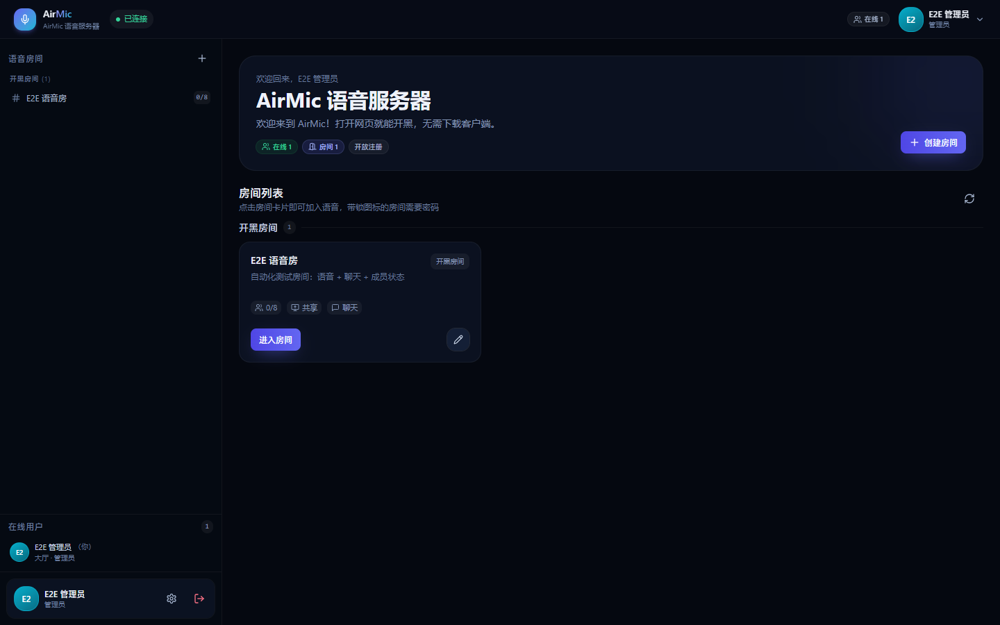
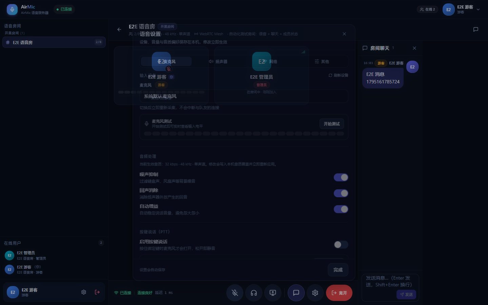
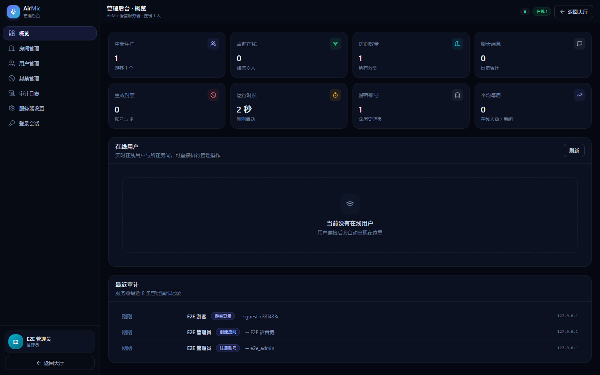
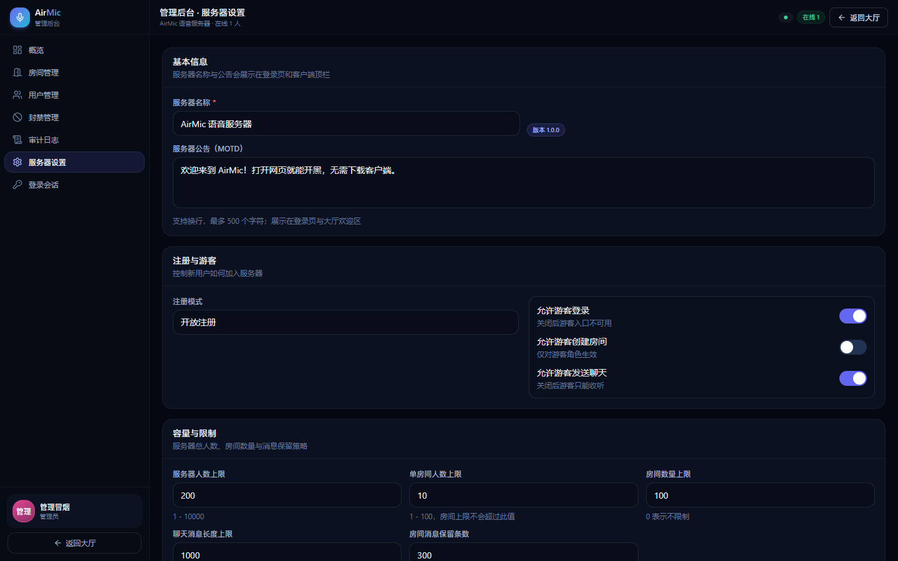

# AirMic

**打开浏览器就能开黑的网页语音平台。** AirMic 使用 WebRTC Mesh 在浏览器之间建立实时语音，服务端只负责账号、房间、权限、信令与状态同步；不需要安装客户端，也不依赖原生模块（SQLite 使用 Node 内置的 `node:sqlite`）。

> 适用场景：小队开黑、内网语音室、桌游/剧本杀房间、远程协作的语音讨论。
> 想了解内部实现？见 [docs/ARCHITECTURE.md](docs/ARCHITECTURE.md)；部署到服务器见 [docs/DEPLOY.md](docs/DEPLOY.md)。

---

## 功能特性

- **账号体系**：注册 / 登录 / 游客登录；注册模式支持开放、邀请码、关闭；首个注册用户自动成为管理员；角色分为管理员 / 版主 / 用户 / 游客，权限点在服务端校验。
- **房间管理**：房间分类、简介、可选密码、人数上限、锁定房间、允许/禁止屏幕共享；管理员与版主可创建、修改、删除房间。
- **WebRTC Mesh 语音**：低延迟点对点语音，支持麦克风开关、耳聋、按键说话（PTT）、每用户本地音量、说话高亮、连接质量（RTT / 丢包 / 码率）显示、断线自动重连。
- **音质可调**：内置 4 个预设（省流语音 / 标准语音 / 高清语音 / 音乐）与自定义参数；支持服务器默认、房间覆盖、本机覆盖三级生效顺序，并通过 Opus SDP 参数与码率控制实现。
- **屏幕共享**：房间内共享屏幕画面（同一时间只允许一人共享），基于预先协商的 video transceiver，无需重新协商。
- **房间聊天**：文字消息、系统提示、历史记录（可配置保留条数），聊天限流与长度校验。
- **管理后台**：概览仪表盘、房间管理、用户管理（角色 / 踢出 / 强制静音 / 移动房间）、封禁管理（账号或 IP）、审计日志、服务器设置（含音质与 ICE/TURN）、登录会话。
- **部署友好**：单进程 Node + SQLite，内置前端静态托管；可选 HTTPS 直连；提供 Dockerfile、docker compose、Nginx / Caddy、systemd、coturn 示例与备份、证书脚本。

## 界面预览

| 登录 / 注册 / 游客 | 大厅与房间列表 |
| --- | --- |
|  |  |

| 房间语音（成员、说话高亮、屏幕共享、聊天） | 语音设置（设备 / PTT / 网络） |
| --- | --- |
|  |  |

| 管理后台 · 概览 | 管理后台 · 服务器设置 |
| --- | --- |
|  |  |

> 截图来自自动化 E2E 测试（真实无头 Chrome + 虚拟麦克风，真实 WebRTC 音频连接）。

## 与 TeamSpeak / Discord 类语音软件的对比

AirMic 的媒体流是 **浏览器之间点对点（Mesh）** 传输，服务端只转发信令，不做混音。这与 TeamSpeak 等由服务端承载/转发语音的软件有本质区别：

| 维度 | AirMic（当前版本） | TeamSpeak 类软件 |
| --- | --- | --- |
| 客户端 | 浏览器打开即用，无需安装 | 需要安装专用客户端 |
| 音频拓扑 | WebRTC Mesh，P2P 直连，服务端只转发信令 | 服务端混音 / 转发 |
| 单房间人数 | **建议 ≤ 10 人**（默认上限 10） | 数十人至数百人 |
| 客户端上行带宽 | 每人需要 N-1 路上行（N 为房间人数） | 每人 1 路上行 |
| 弱网/跨 NAT | 依赖 STUN，复杂网络必须部署 TURN | 服务端中转，天然穿透 |
| 加密 | WebRTC 强制 DTLS-SRTP | 视版本与配置 |
| 文本聊天 / 屏幕共享 | 内置 | 视版本 |
| 管理方式 | Web 管理后台 | 客户端 / 服务端权限系统 |
| 部署 | Node 单进程 + SQLite，几乎零运维 | 专用服务端程序 |

### 当前限制（请务必了解）

- **Mesh 模式**：房间内每增加一人，所有参与者都需要多一路上行；公网/弱网下 **建议每房间不超过 10 人**，默认 `maxUsersPerRoom` 也是 10，可在管理后台调整但请谨慎。
- **无服务端混音 / 转码 / 录音**：语音不经过服务器，服务器无法录制、转码或处理媒体；也无法像 SFU 那样服务大房间。
- **公网部署必须准备 TURN**：对称 NAT、企业防火墙、部分移动网络下 P2P 打洞会失败，需要 TURN 中继；只配 STUN 不能保证可用。
- **屏幕共享占用上行带宽**，共享方上行不足会影响所有接收者。
- **单机架构**：SQLite + 内存中的实时状态，暂不支持多实例横向扩展。
- **无移动原生 App、无消息已读 / 好友 / 私聊 / 语音录制**（可在路线图中规划）。
- **聊天记录有限**：每个房间默认只保留最近 300 条（可在管理后台调整），语音不落盘。

## 技术栈

| 层 | 技术 |
| --- | --- |
| 前端 | React 19 + TypeScript + Vite 6 + Tailwind CSS 4 + zustand + react-router 7 |
| 后端 | Node.js + Fastify 5 + @fastify/websocket + @fastify/cookie |
| 数据库 | SQLite（Node 内置 `node:sqlite`，无需编译原生模块，WAL 模式） |
| 实时语音 | WebRTC Mesh（每人与房间内其他人建立一条 PeerConnection） |
| 实时信令 | WebSocket（`/ws`），JSON 消息 |
| 认证 | httpOnly Cookie 中的 JWT（HS256）+ 数据库会话表，可注销 / 封禁即时失效 |
| 部署 | 单进程 HTTP/HTTPS + 内置静态托管，可选 Nginx/Caddy 反向代理 |

## 架构简述

```text
浏览器 A ⇄ WebRTC 音频/视频（P2P）⇄ 浏览器 B
     ⇅ WS /ws（信令、聊天、状态）        ⇅
              Fastify + SQLite（账号、房间、权限、历史消息、设置）
```

- 服务端不转发媒体流，只转发 SDP / ICE 信令；语音/屏幕共享是浏览器之间的 P2P 连接。
- 前端由 Fastify 在生产模式下直接托管 `web/dist`（开发模式用 Vite）。
- 更完整的模块划分、REST API 与 WebSocket 协议见 [docs/ARCHITECTURE.md](docs/ARCHITECTURE.md)。

## 快速开始

### 环境要求

- **Node.js ≥ 22.13**（推荐 24 LTS，以 `package.json` 的 `engines` 字段为准）；npm ≥ 10。
  - SQLite 使用 Node 内置的 `node:sqlite`，无需安装数据库或编译原生模块；启动时出现 `SQLite is an experimental feature` 警告属正常现象。
- 现代浏览器：Chrome / Edge / Firefox / Safari 16+（需要支持 WebRTC、WebSocket 与 ES2022）。
- 麦克风；浏览器要求 **HTTPS 或 localhost** 才能使用麦克风（见下文）。
- Windows / Linux / macOS 均可运行。

### 1. 安装与构建

```bash
npm install
npm run build
```

### 2. 启动

```bash
# Linux / macOS
NODE_ENV=production npm start

# Windows PowerShell
$env:NODE_ENV = "production"
npm start
```

访问 <http://localhost:3000>。

- `npm start` 运行的是构建产物（`server/dist/index.js`），因此必须先 `npm run build`。
- 生产模式建议显式设置 `NODE_ENV=production`（启用静态资源缓存与 info 日志）。
- 首次启动会自动创建 `data/airmic.db`、表结构与数据目录。
- **第一个注册的用户自动成为管理员**；登录页会提示"第一个注册账号将成为管理员"。

### 3. 可选：创建配置文件

```bash
cp .env.example .env          # Windows: Copy-Item .env.example .env
```

按需修改端口、数据库路径、JWT 密钥等，详见下文"配置说明"。也可以跳过这一步，全部使用默认值。

### 4. 开发模式

```bash
npm run dev
```

- 后端：<http://localhost:3000>（`tsx watch` 热重载）
- 前端：<http://localhost:5173>（Vite，`/api` 与 `/ws` 自动代理到 3000）
- 开发时请在浏览器打开 **5173**。localhost 属于安全上下文，因此本地开发可以直接使用麦克风。
- 修改 `shared/` 下的类型或音质定义后，需要重新执行 `npm run build -w @airmic/shared`，前后端才能看到新类型。

### 5. 首次管理员（可选）

如果不想"抢"第一个注册用户，可以在首次启动前通过环境变量创建管理员：

```bash
ADMIN_USERNAME=admin
ADMIN_PASSWORD=请改成足够强的密码
```

规则：**仅当数据库中还没有任何管理员账号时生效**。若同名用户已存在，该用户会被提升为管理员；若两者都不设置，第一个注册的用户成为管理员。

## 配置说明

服务端启动时读取 **项目根目录的 `.env`**（不会读取 `server/.env`）。已存在的系统环境变量优先于 `.env` 中的值。相对路径（`DATABASE_PATH`、`WEB_DIST`、`SSL_KEY`、`SSL_CERT`）均以项目根目录为基准。

| 变量 | 默认值 | 说明 |
| --- | --- | --- |
| `NODE_ENV` | （空） | 设为 `production` 启用生产行为：静态资源缓存 1 小时、日志默认 `info`。反向代理/容器部署请设置。 |
| `HOST` | `0.0.0.0` | 监听地址。反向代理后建议 `127.0.0.1`，只允许本机访问。 |
| `PORT` | `3000` | 监听端口。 |
| `DATABASE_PATH` | `./data/airmic.db` | SQLite 文件路径；目录不存在会自动创建。生产环境请确保该目录可写并定期备份。 |
| `JWT_SECRET` | （空） | JWT 签名密钥。留空时首次启动自动生成并保存在数据库 `settings` 表（`jwt_secret`）。**生产建议显式设置**；修改会使所有会话失效。 |
| `ADMIN_USERNAME` / `ADMIN_PASSWORD` | （空） | 首次启动引导管理员，仅在没有管理员时生效。 |
| `USER_SESSION_TTL_DAYS` | `30` | 普通用户登录会话有效期（天）。 |
| `GUEST_SESSION_TTL_HOURS` | `24` | 游客登录会话有效期（小时）。 |
| `TRUST_PROXY` | `false` | 是否信任反向代理的 `X-Forwarded-For`。放在 Nginx/Caddy/负载均衡后面时设为 `true`，否则封禁、审计、限流拿到的都是代理 IP。 |
| `SSL_KEY` / `SSL_CERT` | （空） | PEM 私钥 / 证书路径，两项都提供时以 HTTPS 启动。局域网自签证书见 `npm run cert`。不在 Node 上终止 TLS 时留空。 |
| `WEB_DIST` | `./web/dist` | 前端构建产物目录；存在 `index.html` 时由 Fastify 托管。 |
| `LOG_LEVEL` | 生产 `info` / 开发 `debug` | `fatal`、`error`、`warn`、`info`、`debug`、`trace`、`silent`。 |
| `CORS_ORIGIN` | （未使用） | 预留项；当前前后端同源部署，代码中未使用。 |
| `BACKUP_DIR` | `./backups` | 仅备份脚本使用：备份输出目录。 |
| `RETENTION` | `10` | 仅备份脚本使用：保留最近 N 份备份，超出自动删除。 |
| `CERT_HOSTS` / `CERT_DAYS` / `OPENSSL_BIN` | — | 仅证书脚本使用：额外 SAN、有效期天数、OpenSSL 路径。 |

> 注意：**服务器名、MOTD、注册模式、人数上限、音质默认值、STUN/TURN 等运行参数不在 `.env` 中**，而是保存在数据库里，通过"管理后台 → 服务器设置"修改，保存后实时广播给在线客户端。

## 浏览器要求与麦克风安全上下文

浏览器只在 **安全上下文（Secure Context）** 下允许 `getUserMedia`：

- ✅ `https://任意地址`（证书有效或用户手动信任后）
- ✅ `http://localhost` / `http://127.0.0.1`
- ❌ `http://192.168.x.x`、`http://公网IP` —— 麦克风会被直接拒绝，页面会提示权限错误。

因此：

1. **本机试用**：`http://localhost:3000` 即可。
2. **局域网访问**（手机、其他电脑）：必须 HTTPS。两种方式：
   - 直接用 Node 启用自签证书：`node scripts/generate-cert.mjs` 生成 `certs/key.pem`、`certs/cert.pem`，在 `.env` 中设置 `SSL_KEY` / `SSL_CERT` 后重启；每台访问设备需要信任该证书（详见 [docs/DEPLOY.md](docs/DEPLOY.md#5-tls-证书)）。
   - 用 Nginx/Caddy 反向代理并配置正式证书或自签证书。
3. **公网访问**：使用域名 + Let's Encrypt（certbot / Caddy 自动申请），并用 TURN 解决 NAT 穿透。

其他建议：Chrome/Edge 对自动播放有策略，进入房间后如听不到声音，点击页面上的"启用声音"按钮即可（浏览器要求用户手势后才能播放音频）。

## 音质设置

AirMic 的音质参数由三部分决定，优先级从低到高：

```text
服务器默认音质  →  房间覆盖（audio_override）  →  用户本机覆盖（浏览器设置，仅本机生效）
```

| 预设 | 码率 | 采样率 | 声道 | DTX | 适用场景 |
| --- | --- | --- | --- | --- | --- |
| 省流语音 | 16 kbps | 24 kHz | 单声道 | 开 | 弱网 / 移动网络 |
| 标准语音 | 32 kbps | 48 kHz | 单声道 | 开 | 日常开黑（默认） |
| 高清语音 | 64 kbps | 48 kHz | 单声道 | 关 | 人声更清晰 |
| 音乐模式 | 96 kbps | 48 kHz | 立体声 | 关 | 放歌 / 音乐（关闭降噪与 AGC） |
| 自定义 | 6–160 kbps | 16/24/32/48 kHz | 单/立体声 | 可选 | 手动调参 |

- **服务器默认**：管理后台 → 服务器设置 → 默认音质（新房间默认继承）。
- **房间覆盖**：创建/编辑房间时可选择预设或自定义，只保存与服务器默认不同的字段。
- **本机覆盖**：房间内"语音设置"中可覆盖当前浏览器的音质参数，不上传到服务器；适合"我的网络差，想用省流"等场景。
- **实现方式**：`getUserMedia` 约束控制回声消除 / 降噪 / 自动增益 / 采样率 / 声道；Opus 的 `maxaveragebitrate`、`stereo`、`usedtx`、`useinbandfec` 通过修改 SDP 的 `a=fmtp` 生效；码率还可通过 `RTCRtpSender.setParameters` 实时调整。立体声/DTX 等需要重新协商的参数由 perfect negotiation 自动处理。

### ICE / TURN

- 默认使用公共 STUN 列表（`stun:stun.l.google.com:19302`、`stun:stun1.l.google.com:19302`、`stun:stun.cloudflare.com:3478`、`stun:stun.miwifi.com:3478`）。
- 跨 NAT/公网使用时必须在 **管理后台 → 服务器设置 → ICE 服务器** 中添加 TURN（支持 username/credential），保存后对新建连接生效。
- `forceRelay`（强制中继）可用于排障，开启后所有媒体走 TURN；TURN 不可用时会直接连不上，不建议长期开启。
- 完整 TURN 部署步骤（coturn、防火墙端口、验证方法）见 [docs/DEPLOY.md](docs/DEPLOY.md#6-turn-中继)。

## 管理后台

- 入口：登录后右上角用户菜单 → **管理后台**（`/admin`）；用户没有任何管理权限时不显示入口。
- 权限模型（`shared/src/permissions.ts`）：

| 角色 | 权限 |
| --- | --- |
| 管理员 `admin` | 全部权限：服务器设置、房间、用户、踢人、封禁、强制静音、审计、创建房间 |
| 版主 `moderator` | 管理房间、踢人、封禁、强制静音、创建房间 |
| 用户 `user` | 创建房间（需服务器开启"允许普通用户创建房间"） |
| 游客 `guest` | 默认无管理权限 |

管理后台功能：

- **概览**：用户数、在线人数、房间数、消息数、封禁数；在线用户列表（踢出 / 静音 / 移动房间）；最近审计。
- **房间管理**：创建、编辑、删除房间，查看实时人数与生效音质。
- **用户管理**：搜索、分页、修改角色、封禁（时长 + 原因）、踢出、强制静音、移动房间、删除（不能删除自己或最后一名管理员）。
- **封禁管理**：账号封禁与 IP 封禁，支持到期时间；封禁后会话立即失效。
- **审计日志**：操作者、目标、时间、IP、详情，可过滤。
- **服务器设置**：服务器名、MOTD、注册模式与邀请码、游客开关、人数/房间/消息上限、聊天开关、屏幕共享开关、默认音质、ICE 服务器、强制中继、房间分类。
- **登录会话**：当前有效的登录会话（用户、IP、UA、创建/过期时间）。

## 常用脚本

| 命令 | 说明 |
| --- | --- |
| `npm run dev` | 同时启动后端（3000，tsx watch）与前端（5173，Vite） |
| `npm run dev:server` / `npm run dev:web` | 单独启动后端 / 前端 |
| `npm run build` | 依次构建 shared → server → web（生产构建） |
| `npm start` | 启动生产服务（需先 build） |
| `npm test` | 后端集成测试（`node:test`，使用临时数据库） |
| `npm run typecheck` | 全仓库 TypeScript 类型检查 |
| `npm run test:e2e` | 端到端冒烟测试（Playwright，需要本机 Chrome/Edge，且先 `npm run build`） |
| `npm run backup` | 备份 SQLite 数据库到 `backups/`（带时间戳、自动校验、保留 N 份） |
| `npm run cert` | 生成本地自签 HTTPS 证书到 `certs/`（需要 OpenSSL） |
| `npm run build -w @airmic/shared` | 修改 `shared/` 后单独构建共享包 |

### 备份

```bash
npm run backup
# 等价于 node scripts/backup.mjs，支持环境变量/参数覆盖：
#   BACKUP_DIR=./backups RETENTION=10 npm run backup
#   node scripts/backup.mjs --db ./data/airmic.db --dir ./backups --retention 10
```

- 使用 SQLite 的 `VACUUM INTO` 生成一致性快照，**服务运行中也可以备份**（WAL 模式下安全）。
- 备份完成后自动执行 `integrity_check`，校验失败会以非零码退出并保留文件用于排查。
- 数据库不存在时会给出明确提示并以非零码退出。
- 脚本可以在任意工作目录执行（自动定位项目根目录），并会读取根目录 `.env` 中的 `DATABASE_PATH` / `BACKUP_DIR` / `RETENTION`。

### 自签证书

```bash
npm run cert
npm run cert -- --force            # 覆盖已有证书
node scripts/generate-cert.mjs 192.168.1.50 airmic.local   # 追加 SAN
```

- 生成 `certs/key.pem` 与 `certs/cert.pem`，SAN 自动包含 `localhost`、`127.0.0.1`、`::1`、本机 hostname 与所有局域网 IPv4。
- 需要 OpenSSL：Linux/macOS 通常自带；Windows 可用 Git for Windows 自带的 OpenSSL（脚本会自动检测 `C:\Program Files\Git\usr\bin\openssl.exe`，也可用 `OPENSSL_BIN` 指定）。
- 生成后在 `.env` 设置 `SSL_KEY` / `SSL_CERT` 并重启；证书只适合内网/测试，公网域名请用 Let's Encrypt。`certs/` 已被 `.gitignore` 忽略，**不要提交私钥**。

## 目录结构

```text
AirMic/
├─ package.json              # npm workspaces 根：dev/build/test/typecheck/test:e2e/backup/cert 脚本
├─ .env.example              # 环境变量模板（服务端 + 脚本）
├─ Dockerfile                # 多阶段生产镜像
├─ docker-compose.yml        # airmic 服务 + 可选 coturn
├─ scripts/
│  ├─ backup.mjs             # SQLite 备份（VACUUM INTO + 校验 + 轮换）
│  └─ generate-cert.mjs      # 局域网自签 HTTPS 证书
├─ e2e/                      # Playwright 端到端冒烟测试（npm run test:e2e）
├─ deploy/
│  ├─ nginx.conf             # Nginx HTTPS + WebSocket 反向代理示例
│  ├─ Caddyfile             # Caddy 自动 HTTPS 反向代理示例
│  ├─ coturn.conf            # coturn TURN 中继配置示例
│  └─ airmic.service         # systemd unit 示例
├─ docs/
│  ├─ ARCHITECTURE.md        # 架构 / REST API / WebSocket 协议
│  ├─ FRONTEND.md            # 前端开发说明
│  └─ DEPLOY.md              # 生产部署指南
├─ shared/src/               # 前后端共享契约：类型、协议、音质预设、权限
├─ server/
│  ├─ src/                   # Fastify：config/db/services/routes/realtime/plugins
│  ├─ tests/                 # node:test 集成测试
│  └─ dist/                  # 构建产物（npm run build 生成）
├─ web/
│  ├─ src/                   # React 前端（页面、组件、stores、voice 引擎）
│  └─ dist/                  # 构建产物（生产由 Fastify 托管）
└─ data/                     # 运行时 SQLite 数据库（gitignored，需备份）
```

## 常见问题（FAQ）

### 进房间后听不到声音 / 无法说话？

按顺序排查：

1. **地址**：必须 `https://` 或 `http://localhost`，`http://局域网IP` 下浏览器会禁用麦克风。
2. **权限**：浏览器地址栏的麦克风图标、操作系统麦克风权限（Windows 隐私设置 / macOS 安全性与隐私）。
3. **设备**：语音设置里选择正确的输入设备，确认没有被系统静音或占用。
4. **状态**：自己是否按了"麦克风关闭"、是否处于 PTT 模式（需要按住按键说话）、是否被管理员强制静音。
5. **自动播放**：其他人说话无声音时，点击页面上的"启用声音"按钮（浏览器自动播放策略）。
6. **看日志**：浏览器 DevTools Console 是否有 `NotAllowedError` / `NotFoundError`；服务端 `LOG_LEVEL=debug` 查看 WebSocket 信令。

### 公网 / 跨网络一直连不上，ICE 状态 failed？

典型 NAT 穿透失败，**只配 STUN 不够**，需要部署 TURN 并在管理后台填写：

- 按 [docs/DEPLOY.md](docs/DEPLOY.md#6-turn-中继) 部署 coturn，放行 3478/tcp+udp 与 49160-49200/udp。
- 管理后台"服务器设置 → ICE 服务器"添加 `turn:你的域名:3478?transport=udp` 与 `turn:...?transport=tcp`，填写 username/credential。
- 用 <https://webrtc.github.io/samples/src/content/peerconnection/trickle-ice/> 测试是否能看到 `relay` 候选。
- 排障时可临时开启"强制中继"，确认 TURN 是否可用。

### 浏览器提示阻止自动播放 / 没有声音？

浏览器要求用户手势后才能播放音频。点击房间页的"启用声音"按钮即可；Safari 对此更严格，建议使用 Chrome/Edge。该操作只需一次，之后会自动恢复。

### 如何备份数据、迁移到新服务器？

1. 运行 `npm run backup`（会生成 `backups/airmic-YYYYMMDD-HHmmss.db`）。
2. 迁移时复制三样东西：**备份的数据库文件**、**项目根目录的 `.env`**（尤其是 `JWT_SECRET`）、`certs/`（如果用了自签证书）。
3. 新服务器安装依赖、构建后，把备份文件放回 `data/airmic.db`（先停止服务，并删除旧的 `-wal` / `-shm` 文件），再启动。
4. Docker 部署时数据在命名卷 `airmic-data` 中，备份命令：`docker compose exec airmic node scripts/backup.mjs`，详见 [docs/DEPLOY.md](docs/DEPLOY.md#7-数据备份与恢复)。

### 端口 3000 被占用怎么办？

- 修改 `.env` 中的 `PORT`（例如 3001），重启服务；反向代理/端口映射同步修改。
- Docker：`docker compose up` 时改为 `-p 3001:3000`（容器内仍是 3000）。
- 查看占用：Linux `ss -lntp | grep 3000`；Windows `Get-NetTCPConnection -LocalPort 3000`。

### 游客有哪些限制？

- 是否允许游客登录由管理后台"服务器设置 → 开启游客模式"控制（默认开启）。
- 游客没有密码、无管理权限；默认**不能创建房间**（可由管理员开启"允许游客创建房间"）。
- 游客聊天受"允许游客聊天"开关与服务器聊天开关控制。
- 游客账号会在 7 天后由服务端自动清理；游客会话默认 24 小时过期（`GUEST_SESSION_TTL_HOURS`）。

### 同一账号能同时登录多台设备吗？

账号可以多处登录，但 **WebSocket 实时连接只保留最新的一个**：新连接会挤掉旧连接（旧页面显示连接断开并尝试重连）。如果需要在两台设备同时语音，请使用两个账号。

### 数据库能同时被两个进程打开吗？

不建议。SQLite + WAL 支持并发读写，但 AirMic 的实时状态在进程内存中，**同一数据库只能由一个 AirMic 实例使用**。备份脚本可以和服务同时运行（一致性快照），但不要启动两个服务实例指向同一个数据库。

### 启动时出现 `SQLite is an experimental feature` 警告？

这是 Node 内置 `node:sqlite` 的实验性 API 提示，不影响功能。在 Node 22/24 上均可忽略。

## 安全建议

- **使用强随机 `JWT_SECRET`**（或留空，让服务端首次启动自动生成并保存到数据库），不要使用示例/公开密钥；修改后所有会话失效。
- **生产必须启用 HTTPS**（Nginx/Caddy + Let's Encrypt 或自签证书），并确保 `TRUST_PROXY=true` 只配置在可信反向代理之后。
- 反向代理后把 `HOST` 设置为 `127.0.0.1`，不要直接把 3000 端口暴露到公网。
- 使用**邀请码或关闭注册**（管理后台 → 服务器设置），避免陌生人注册；管理员账号使用强密码。
- 定期执行 `npm run backup` 并把备份复制到另一台机器/对象存储（脚本只保留最近 N 份，且与数据库在同一磁盘不算异地备份）。
- 在 Nginx / 云负载均衡上再加一层限流（`limit_req`），保护登录与注册接口（服务端已有基础 IP 限流：注册 10 次/10 分钟、登录 20 次/5 分钟、游客 10 次/10 分钟）。
- 及时跟进 Node.js 安全更新；以非 root 用户运行（systemd unit 已配置 `User=airmic`，Docker 镜像使用 `node` 用户）。
- 不要把 `.env`、`data/`、`certs/` 提交到 Git（已在 `.gitignore` 中忽略）。
- TURN 使用强密码并定期更换；只放行必要端口；不要开启 coturn 的 CLI（配置已含 `no-cli`）。

## 路线图（Roadmap）

以下为可选的后续方向，当前版本尚未实现：

- **SFU 模式**：引入 mediasoup / LiveKit 等服务端转发，支持每房间几十人、降低客户端上行压力；可保留 Mesh 作为小房间模式。
- **消息已读 / 未读**、@提醒、私聊与好友系统。
- **语音录制 / 回放**（需要服务端参与媒体，属于较大改动）。
- **移动端优化**：PWA、后台保持语音、蓝牙设备切换。
- **认证扩展**：OIDC / LDAP 登录、邮箱注册验证与密码找回。
- **可观测性**：Prometheus 指标、结构化日志、健康检查增强。
- **TURN 临时凭证**（TURN REST API），避免在客户端配置静态长期凭证。
- **多实例部署**：Redis 共享会话与实时状态、外部对象存储。

## 测试与验证

```bash
npm test                 # 后端集成测试（node:test，61 个用例：认证/房间/管理/实时信令/WebRTC 信令）
npm run typecheck        # 全仓库 TypeScript 类型检查
npm run test:e2e         # 浏览器端到端测试（需先 npm run build，本机 Chrome/Edge）
```

- **后端测试**覆盖：注册登录/游客/权限、房间 CRUD 与密码、音质参数合并与 SDP 修饰、
  管理后台全部接口与审计、WebSocket 认证/心跳/加入房间/聊天/信令转发/屏幕共享互斥/踢人/静音/移动/封禁等。
- **E2E 测试**（`e2e/e2e.mjs`）会启动生产构建的服务器与无头 Chrome（虚拟麦克风），真实验证：
  注册建号 → 创建房间 → 游客登录 → 管理后台渲染 → 双人进入房间 → **WebRTC 音频连接建立并收到远端媒体**
  → 聊天互通 → 静音状态同步 → 语音设置 → 离开房间，同时检查控制台错误并输出截图到 `e2e/artifacts/`。

## 相关文档

- [docs/ARCHITECTURE.md](docs/ARCHITECTURE.md)：架构、数据模型、REST API、WebSocket 协议、实时层职责。
- [docs/FRONTEND.md](docs/FRONTEND.md)：前端结构、页面功能与语音引擎契约。
- [docs/DEPLOY.md](docs/DEPLOY.md)：生产部署（systemd / Docker / Nginx / Caddy / TLS / TURN / 备份恢复 / 升级排障）。

## 许可证

[MIT](LICENSE)